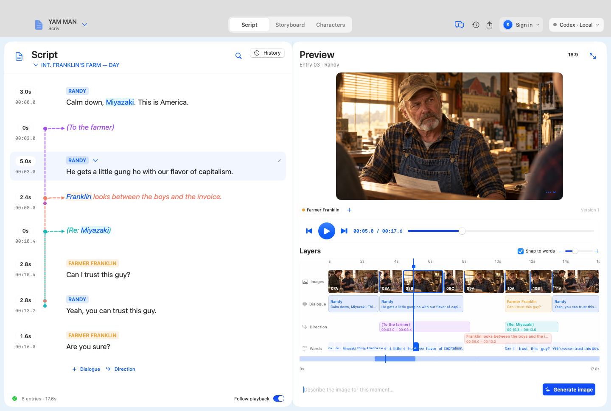

# Scriv

A native Mac workspace for writing a script, timing its words and directions, and playing it as a visual storyboard.

Scriv’s application target is **UIKit with Mac Catalyst**, with no SwiftUI hosting or legacy SwiftUI views compiled into it. The old SwiftUI/AppKit target and its packaging path are retired; their exact source remains recoverable from Git history. `apps/mac` still contains shared Core, domain/cloud services and resources used by the current app. See the [retirement scope and recovery record](docs/verification/appkit-retirement-20261109.md). The cloud service runs on Cloudflare Workers, D1, SQLite Durable Objects and private R2 storage. All original design assets and project data formats are retained.

**UIKit migration:** [implementation and verification boundary](docs/verification/uikit-migration-20261030.md). The UIKit source and portable tests are implemented; the native SDK build, real interaction, companion launch/pairing and screenshot audit remain explicit gates, not implied by Linux checks.

**Earlier source handoff:** the later workspace, audio, discussion, history, generation, source-owned timing, character-link, durable editor recovery, email sign-in and collaboration changes are described in the [current integration handoff](docs/verification/current-handoff.md). These changes have **not** been compiled or run as a native Mac app in the Linux workspace. The successful [historical CI run](https://github.com/pcopu/scriv/actions/runs/40921544866), universal development build and screenshots apply only to [runtime commit `f39ceb8`](https://github.com/pcopu/scriv/commit/f39ceb827d78c5a2694cee489725969173c43ded), not current `main`. [Verification](docs/verification.md) separates those results from current local evidence; the [deployment handoff](docs/deployment.md) retains production, signing and live-account acceptance gates.

**Backend:** deployed at `https://scriv-api.muddy-recipe-a722.workers.dev`, with D1, private R2 and email-code login. [Deployment evidence](docs/verification/cloud-deployment-20261029.md) distinguishes service checks from delivery/session acceptance. Stripe and multiplayer acceptance are deferred; native release/signing remains unverified.



*Actual SwiftUI/AppKit application capture. View the [Script](docs/screenshots/01-script.png), [Characters](docs/screenshots/02-characters.png) and [Storyboard](docs/screenshots/03-storyboard.png) screenshots, with build provenance in the [capture notes](docs/screenshots/README.md). The original approved concepts remain in [design/images](design/images).*

## The workspace

| View | What it does |
| --- | --- |
| **Script** | One left-aligned flow of dialogue and direction, duration pills, linked character names, forward-extending colored direction rails, image preview and layered playback editor. |
| **Storyboard** | Full-width image cards, duration pills, individual word selection and rectangular marquee selection. Drag a shared cut or a contiguous edge-word selection between neighboring images. |
| **Characters** | Stable character profiles and aliases, appearance notes, portraits, tagged images and immutable image versions. |
| **Discussion** | A compact project/item panel with replies, image-version attachments and resolved threads. |
| **History** | Local saved revisions and the complete paginated cloud event history; restoring creates a new revision. |

Directions have **owned time** and **coverage**. A direction may own zero seconds while extending forward over other lines. Extending its coverage never adds time. Moving an image cut preserves the two cues' combined duration and the script's word order. The [design specification](docs/design.md) and [timing fixture](design/storyboard-timing-example.json) define the interaction precisely.

The bundled farm-scene sample includes the full 56.3-second authored sequence and three real sample images. The selected storyboard excerpt retains its original full-scene time offsets.

## Free and Team

| Capability | Free personal project | Team — USD $9.99/month |
| --- | --- | --- |
| Local writing, timing, playback, import/export | Included | Included |
| Hosted scripts, timing, character metadata, image prompts and history | Included after Scriv sign-in | Included |
| Local Codex image generation | Uses your own local Codex account | Uses each member's own local Codex account |
| Image transfer between authorized devices | Your own devices | Team members' devices |
| Live collaboration, cursors and exclusive item editing | — | Included |
| Project/item discussions with collaborators | — | Included |
| Private hosted image replicas | — | Included within the configured storage quota |
| Team membership | One person | No per-seat charge or membership cap |

Only **image binary hosting** is paid-only. In linked cloud projects, scripts, authored timing and image metadata—including the exact captured generation text for each new image version—sync for free accounts too. Manual visual direction remains separate. Older/imported images without a captured generation prompt are explicitly unknown, not reconstructed from the current script. Private runtime paths, reference-image bytes and Codex credentials are never injected into that text metadata.

The subscription is **one recurring $9.99 USD payment per team, quantity one**. Owners can create reusable, expiring and revocable invitation links. Viewers, members, admins and the owner have distinct permissions. The initial hosted-media quota is 10 GiB/team and 25 MiB/image; membership is not metered. There is a 1,000-connection protection limit per live project room, independent of team membership.

Cloudflare's Workers Paid plan is the infrastructure starting point. Its $5 base fee is not a promise that all storage, requests, Durable Object work and optional TURN traffic will fit within $5. See [deployment and capacity notes](docs/deployment.md).

## Test through Tracer

Use `tracer actions` to discover Scriv's CLI and `tracer app -- test --list`
to list the real native scenarios. Run them on macOS with
`tracer app -- test --app /path/to/ScrivAutomation.app`; use
`--scenario journeys/project-roundtrip` for an explicitly labeled subset.
The front door delegates to the existing actual-app runner, with no mock fallback.

`tracer app -- test tooling` checks the public Tracer/CLI boundary without
launching a native app. It is not native coverage. See the
[front-door workflow and verification limits](docs/testing/tracer-front-door.md)
and [native run evidence contract](docs/testing/cli-run-evidence.md).
Optional [per-session LLVM coverage](docs/testing/cli-scenario-coverage.md) runs
through the same Tracer front door with a pinned coverage build, separate
cumulative profile pairs and real LCOV import. Native verification remains pending.
Legacy test suites were removed at the user's request. Their frozen ledger and
unverified gaps remain; neither test nor old-app retirement certifies native parity.

## Build the UIKit Mac app

Use macOS 14+ with **Xcode 26.2 or newer** for the current UIKit SDK APIs (availability guards retain the older deployment target). Codex is optional for writing and playback.

```sh
git clone https://github.com/pcopu/scriv.git
cd scriv
bash scripts/build-catalyst.sh
# Optimized product: build/catalyst/Build/Products/Release-maccatalyst/Scriv.app
# Debugger build: SCRIV_CONFIGURATION=Debug bash scripts/build-catalyst.sh
```

`apps/catalyst/ScrivUIKit.xcodeproj` contains the UIKit app target, native adapter and bundled on-demand runtime XPC service. Its deterministic generator requires only Python 3, not XcodeGen. `scripts/verify-catalyst.sh` checks source/target integrity and, with a Swift toolchain installed, syntax on Linux; it does **not** type-check UIKit. Compilation, actual native interaction and signed installation/relaunch are separate verification gates. `npm run build:mac` builds this Catalyst target. The old AppKit build is retired; its historical screenshots do not show the current UIKit target.

Local writing, timing, playback and `.scriv` packages do not require sign-in. Use Projects → Open to explicitly grant access to an existing package; the Catalyst app does not assume access to the legacy app’s storage. Accepted mutations enter a private, account-scoped write-ahead journal before publication. Recovery refuses changed sources rather than overwriting them. Script and Characters share the smaller text baseline and one persisted Cmd+/Cmd− zoom preference. Space plays/pauses outside text editing; normal spaces and IME composition remain text input. Cmd+Enter toggles script editing.

Open **Codex…** from the workspace's three-dot menu for a compact connection popup. **Connect** finds and starts the installed Codex runtime through the bundled, on-demand local helper. The deliberate Connect action authorizes startup without a second pairing prompt. No server address or Terminal listener is required; the helper supplies its own connection. **Advanced…** opens the Codex pane in the native Settings window, where installation help, manual connection and pairing controls are available. The saved WebSocket address is used only by **Connect to this address**. Opening the popup or Settings starts nothing. The helper can access Codex and generation files as the current Mac account; credentials stay local. A build without Catalyst Keychain entitlement can retain its authenticated pairing for the app session only after persistent-grant absence is verified. Cancellation saves nothing, and inaccessible or conflicting existing grants still fail closed. The separately built [Runtime Companion](apps/runtime-bridge/README.md) remains available for explicit pairing. Building either product does not launch a runtime. Distributable releases require authorized Developer ID signing and notarization.

### In-app updates

**Scriv → Settings…** (⌘,) opens a native Settings window with General, Account, and Codex panes. **Scriv → Check for Updates…** uses a UIKit sheet and native Sparkle plug-in, with durable-save fences and signed feed/archive checks. Development/ad-hoc builds cannot install updates. [Update policy and build instructions](docs/app-updates.md), [service setup](updates/README.md), and [native acceptance procedure](docs/signed-update-acceptance.md) describe separate release and installation gates.

### Two independent accounts

**Scriv account:** the account control sends a six-digit email code and verifies it in the app to access hosted scripts and teams. Codes are short-lived, single-use and bound to the requesting sign-in flow. Scriv session tokens are stored in Keychain and scoped to the API origin. Existing GitHub identities remain supported separately; matching contact emails do not silently merge accounts.

**Codex on this Mac:** A user-authorized bundled helper or explicitly paired, same-user Runtime Companion launches the installed `codex app-server`. The separate **Connect to this address** action in Settings attaches to an explicitly configured loopback WebSocket endpoint. Sign in with ChatGPT is handled by Codex. Stop terminates only the child Scriv started; disconnecting an external server leaves that server running. No ChatGPT credential is sent to Scriv's cloud.

Image generation requests a real image file in an isolated local generation directory. The installed Codex runtime, selected model and account must support image generation. Scriv reports an actual missing-capability or missing-file error instead of substituting an image. This integration still requires the live-account release smoke test described in the handoff.

The former Codex **0.165.0** contract-check results are historical. The old contract suite has been removed; retained live CLI journeys remain separately gated. See [current testing](docs/testing/cli-only-tests.md).

## Run the backend locally

Requirements: Node.js 22.14+ and npm. Cloud credentials are unnecessary for the isolated automated tests.

```sh
npm ci
npm --prefix cloud ci
cp cloud/.dev.vars.example cloud/.dev.vars
npm --prefix cloud run db:migrate:local
npm run dev:cloud
```

The isolated service CLI journey forbids outbound delivery and never sends live mail. Interactive email sign-in requires a configured Email Sending binding and verified sender, or point the app at the deployed HTTPS service. Optional legacy GitHub OAuth needs a separate development OAuth app. There is no local authentication bypass. Stripe and TURN remain separate optional integrations; see [cloud setup](cloud/README.md).

## Verify through Tracer

```sh
npm run check
npm test                         # Public CLI behavior through Tracer
npm run test:services             # Isolated real Worker HTTP journeys
npm run test:e2e -- --list        # Native CLI catalog; no app launch
# Explicit native selection requires a matching automation Catalyst app:
tracer app -- test --scenario journeys/project-roundtrip --app /path/ScrivAutomation.app
```

Use an installed Tracer or set `SCRIV_TRACER_CLI` to its trusted absolute
entrypoint. Legacy test suites, targets and test-only dependencies are removed.
Build/release integrity checks remain. [CLI-only testing](docs/testing/cli-only-tests.md)
records exact deletion scope, recovery checkpoint, retained gaps and commands.
A CLI/tooling pass is not native UI parity or 100% measured coverage. The workflow
has been updated locally; no remote run was dispatched or verified here.

## Project map

- [structure.md](structure.md): current runtime boundaries and the retained historical source map.
- [Current architecture and schema](docs/architecture.md): local storage, cloud schema, collaboration and billing decisions.
- [Cloud API](docs/cloud-api.md): the native/server protocol and error contract.
- [Deployment handoff](docs/deployment.md): configuration, release commands, production smoke tests and rollback.
- [Verification report](docs/verification.md): measured results and explicit production-account gates.
- [Product design](docs/design.md), [current concepts](design/images) and [earlier concepts](design/archive/README.md).
- [Original multiplayer proposal](docs/multiplayer-design.md): retained design history; its Redis/Postgres/$10 proposal is superseded by the current Cloudflare/$9.99 implementation.

MIT licensed. See [LICENSE](LICENSE).
