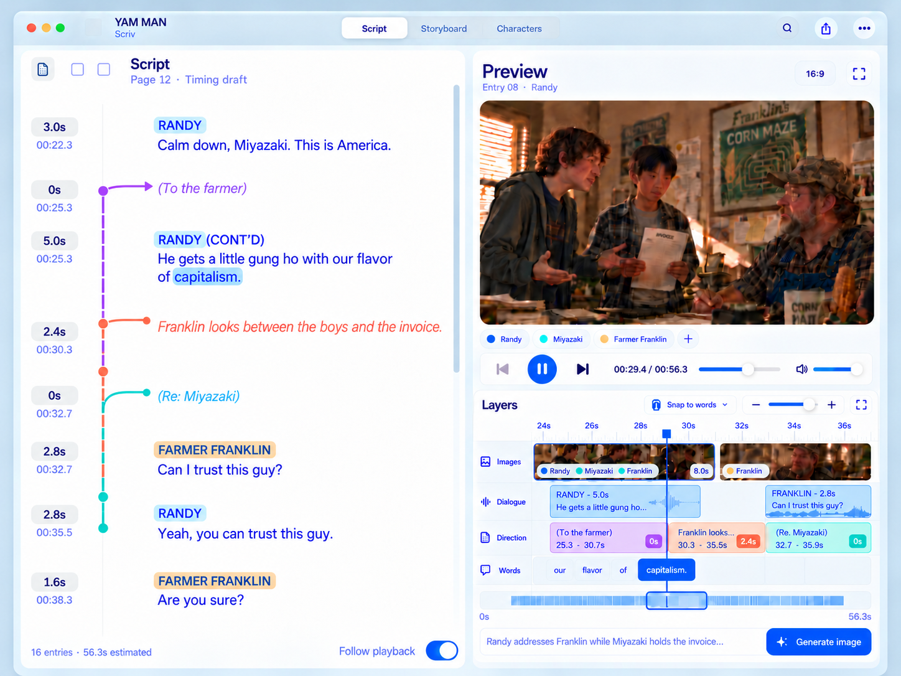

# Scriv

A native Mac workspace for writing a script, timing its words and directions, and playing it as a visual storyboard.

Scriv is a new SwiftUI/AppKit application. The inherited Movie AI Workspace implementation has been removed; the Git history and all 25 Scriv design images remain available. The cloud service runs on Cloudflare Workers, D1, SQLite Durable Objects and private R2 storage.

**Release status:** implementation and verification are in progress. This repository contains the application, backend, tests and packaging workflow. No production service, paid subscription or signed public release has been created. [Verification](docs/verification.md) records the actual test results and remaining release gates; [deployment handoff](docs/deployment.md) explains the account configuration and release procedure.



*The image above is the approved design reference. The macOS CI job captures the actual Script, Characters and Storyboard views as downloadable build artifacts.*

## The workspace

| View | What it does |
| --- | --- |
| **Script** | One left-aligned flow of dialogue and direction, duration pills, linked character names, forward-extending colored direction rails, image preview and layered playback editor. |
| **Storyboard** | Full-width image cards, duration pills, individual word selection and rectangular marquee selection. Drag a shared cut or a contiguous edge-word selection between neighboring images. |
| **Characters** | Stable character profiles and aliases, appearance notes, portraits, tagged images and immutable image versions. |
| **Discussion** | A compact project/item panel with replies, image-version attachments and resolved threads. |
| **History** | Local saved revisions and the complete paginated cloud event history; restoring creates a new revision. |

Directions have **owned time** and **coverage**. A direction may own zero seconds while extending forward over other lines. Extending its coverage never adds time. Moving an image cut preserves the two cues' combined duration and the script's word order. The [design specification](docs/design.md) and [timing fixture](design/storyboard-timing-example.json) define the interaction precisely.

The bundled farm-scene excerpt includes three real sample images. It starts at zero for playback; the design fixture retains the original full-scene time offsets.

## Free and Team

| Capability | Free personal project | Team — USD $9.99/month |
| --- | --- | --- |
| Local writing, timing, playback, import/export | Included | Included |
| Hosted scripts, character metadata and history | Included after Scriv sign-in | Included |
| Local Codex image generation | Uses your own local Codex account | Uses each member's own local Codex account |
| Image transfer between authorized devices | Your own devices | Team members' devices |
| Live collaboration, cursors and exclusive item editing | — | Included |
| Project/item discussions with collaborators | — | Included |
| Private hosted image replicas | — | Included within the configured storage quota |
| Team membership | One person | No per-seat charge or membership cap |

The subscription is **one recurring $9.99 USD payment per team, quantity one**. Owners can create reusable, expiring and revocable invitation links. Viewers, members, admins and the owner have distinct permissions. The initial hosted-media quota is 10 GiB/team and 25 MiB/image; membership is not metered. There is a 1,000-connection protection limit per live project room, independent of team membership.

Cloudflare's Workers Paid plan is the infrastructure starting point. Its $5 base fee is not a promise that all storage, requests, Durable Object work and optional TURN traffic will fit within $5. See [deployment and capacity notes](docs/deployment.md).

## Run on a Mac

Requirements: macOS 14+, Xcode 15.4+ or a compatible newer Swift toolchain. OpenAI Codex is optional for writing and playback; install it separately if you want image generation.

```sh
git clone https://github.com/pcopu/scriv.git
cd scriv
swift test --package-path apps/mac
bash scripts/build-mac.sh
open build/Scriv.app
```

The package script produces `build/Scriv.app` and `build/Scriv-macOS.zip`. Development builds are ad-hoc signed. A distributable release requires your Developer ID signing identity and Apple notarization; the scripts and exact commands are in the [handoff](docs/deployment.md).

The app opens locally without signing in. Use **File → Open Project** for a `.scriv` package, **Import Script** for Fountain/plain-text scripts, or the sample project to explore the three views. The sample, local saves and local history do not require the cloud. Settings can select the deployed API URL; the development default is `http://127.0.0.1:8787`.

### Two independent accounts

**Scriv account:** the top-right account control signs in through GitHub OAuth to access hosted scripts and teams. Scriv session tokens are stored in Keychain and scoped to the API origin.

**Codex on this Mac:** Start launches the installed `codex app-server` as a child process. Connect attaches to an explicitly configured loopback WebSocket endpoint. Sign in with ChatGPT is handled by Codex. Stop terminates only the child Scriv started; disconnecting an external server leaves that server running. No ChatGPT credential is sent to Scriv's cloud.

Image generation requests a real image file in an isolated local generation directory. The installed Codex runtime, selected model and account must support image generation. Scriv reports an actual missing-capability or missing-file error instead of substituting an image. This integration still requires the live-account release smoke test described in the handoff.

The protocol is checked against the official Codex **0.165.0** generated schema, with 18 passing contract checks. See [Codex integration](docs/codex-integration.md) for the tested version and reproducible validation.

## Run the backend locally

Requirements: Node.js 22.14+ and npm. Cloud credentials are unnecessary for the isolated automated tests.

```sh
npm ci
npm --prefix cloud ci
cp cloud/.dev.vars.example cloud/.dev.vars
npm --prefix cloud run db:migrate:local
npm run dev:cloud
```

Configure a development GitHub OAuth app for interactive Scriv login. Local development does not offer an authentication bypass. Stripe and TURN credentials are optional until you exercise those integrations. See [cloud setup](cloud/README.md) for provider-specific configuration.

## Verify

```sh
npm run check
npm test
npm --prefix cloud run test:load
npx playwright install chromium
npm run test:peer
swift test --package-path apps/mac
bash scripts/build-mac.sh
```

The Cloudflare tests run inside the real Workers runtime with local D1, Durable Objects and R2 bindings. The peer tests use real Chromium WebRTC data channels. Swift core tests can also run on Linux; compiling the native interface and rendering its screenshots require macOS.

CI runs the backend, fixture and peer tests plus the native Mac build, packages the `.app`, then captures all three native views. It does not deploy, create Stripe charges, sign with a private Developer ID certificate or log into a ChatGPT account.

## Project map

- [structure.md](structure.md): complete source map, runtime responsibilities and file formats.
- [Current architecture and schema](docs/architecture.md): local storage, cloud schema, collaboration and billing decisions.
- [Cloud API](docs/cloud-api.md): the native/server protocol and error contract.
- [Deployment handoff](docs/deployment.md): configuration, release commands, production smoke tests and rollback.
- [Verification report](docs/verification.md): measured results and explicit production-account gates.
- [Product design](docs/design.md), [current concepts](design/images) and [earlier concepts](design/archive/README.md).
- [Original multiplayer proposal](docs/multiplayer-design.md): retained design history; its Redis/Postgres/$10 proposal is superseded by the current Cloudflare/$9.99 implementation.

MIT licensed. See [LICENSE](LICENSE).
