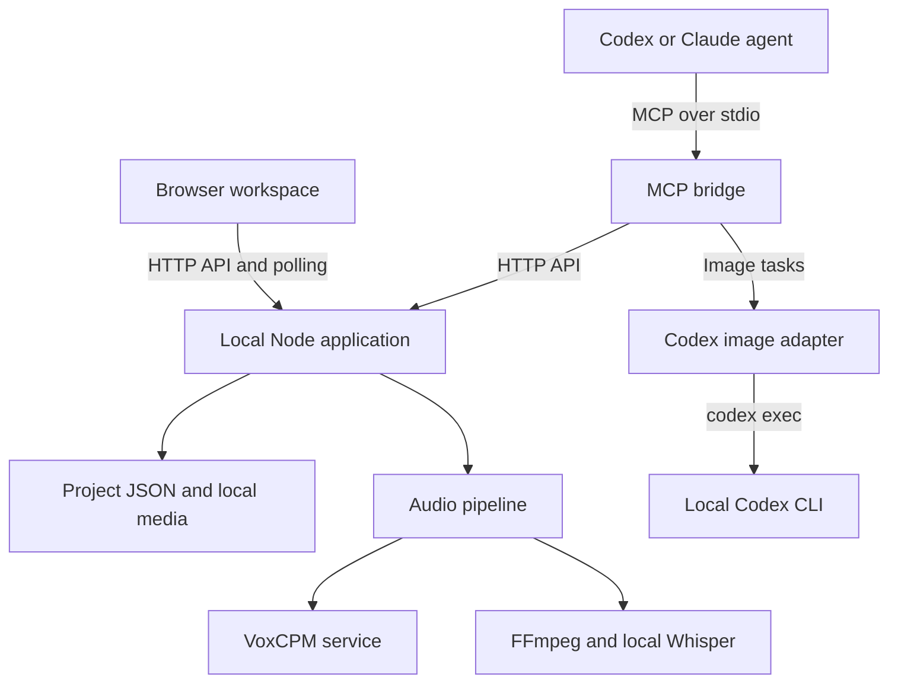

# Scriv — repository structure and code map

This document maps the inherited code before Scriv's interface or application behavior is changed. It describes what exists, how the pieces connect, and what the proposed script-first product will need.

## 1. Snapshot and product direction

| Item | Reviewed value |
| --- | --- |
| Repository | [pcopu/scriv](https://github.com/pcopu/scriv), public fork |
| Upstream | [Yuuhann1999/agent-storyboard](https://github.com/Yuuhann1999/agent-storyboard) |
| Source commit | `a640a3b4d91d278253083833ad0cfa277f3fd84f` |
| Review date | 2026-10-28 |
| Current application identity | Agent Storyboard, version `0.8.0` |
| License | [MIT](LICENSE), with the upstream copyright notice |
| Inventory | 110 tracked files before adding this document; 31 are bundled copies of the application |
| Stack | Node.js ES modules; native HTTP server; vanilla HTML, CSS and browser JavaScript; JSON files and local media |
| npm dependencies | None declared; no frontend build pipeline or package lockfile |

The intended Scriv experience is a writing workspace with a Scrivener-like binder, an editable script, timing and generated imagery associated with each script line or beat, and playback that advances the script and images together. The longer-term deployment is a central workspace for multiple people. Codex app-server is the preferred future image-generation integration.

Those are product goals, not existing features. The current fork is a local storyboard workbench. Its main reusable unit is a **shot** with an ID, dialogue, duration, visual prompt, generation state and one current media URL.

### The six architectural facts that matter most

1. `scriptDraft` is a plain string, stored separately from `shots[].dialogue`. There is no durable link between a span of the draft and a shot.
2. Shots already have durations in seconds and optional aligned start/end times in milliseconds. They can be a useful foundation for timed script beats.
3. The voice player highlights aligned dialogue while audio plays. The storyboard presenter is a manual gallery; it does not advance images on a project clock.
4. The browser queues generation tasks. An external agent processes them. The bundled image bridge invokes `codex exec`; it does not use app-server.
5. Projects and media live on one local filesystem. There are no user accounts, workspace memberships or access-control rules.
6. The standalone application is duplicated into the plugin. Both copies need to stay synchronized until packaging changes.

The `private: true` field in [package.json](package.json) prevents npm package publication. It does not make the GitHub repository private.

## 2. System architecture



There are two principal execution modes:

| Mode | Entry point | Application files | Persistent data |
| --- | --- | --- | --- |
| Standalone development | `npm start` | Root `server.mjs` and `public/` | `./data`, explicitly selected by the npm script |
| Installed agent plugin | `plugins/agent-storyboard/mcp/server.mjs` | `plugins/agent-storyboard/app/` | Normally `~/.agent-storyboard`, with legacy-directory compatibility |

The browser talks to the HTTP server; it never invokes the MCP process directly. The MCP bridge can start the bundled HTTP application and then operate it through the same API. Native image generation performed by the surrounding agent is another supported task-processing route; it returns a local file through the completion API.

Sources: [server.mjs](server.mjs), [MCP server](plugins/agent-storyboard/mcp/server.mjs), [codex-image.mjs](codex-image.mjs), [audio.mjs](audio.mjs).

## 3. Main source modules

| File | Responsibility and important entry points |
| --- | --- |
| [server.mjs](server.mjs) | HTTP server; project normalization and persistence; shot/cover CRUD; uploads; task lifecycle; audio job orchestration; media serving; DOCX generation. Main handlers: `handleApi`, `handleProjectsApi`, `handleShotsApi`, `handleCoversApi`, `handleGenerationApi`. |
| [codex-image.mjs](codex-image.mjs) | Local Codex subprocess adapter. Exports `ImageGenError`, `buildInstruction`, `generateImageWithCodex`, `codexImageAvailable`. |
| [audio.mjs](audio.mjs) | Voice synthesis, sentence-aware chunking, reference transcription, FFmpeg processing and Whisper alignment. Exports `generateVoice`, `splitVoiceText`, `transcribeReference`, `alignVoice`, `audioDuration`. |
| [voxcpm.mjs](voxcpm.mjs) | Dependency-free Gradio HTTP client for VoxCPM. Exports `VOXCPM_API_BASE`, `voxcpmBase`, `parseEventStream`, `generateVoxcpm`. |
| [runtime.mjs](runtime.mjs) | Executable/model discovery, bounded subprocess runner and environment checks. Exports runtime paths, `run`, `findWindowsBinary`, `findWhisperModel`, `inspectEnvironment`. |
| [recognition.mjs](recognition.mjs) | `matchRecognition`: aligns ordered shot dialogue to recognized text and timestamps. |
| [timing.mjs](timing.mjs) | `spokenText`, `dialogueKey`, `voiceTextsMatch`, `estimateTiming`, `applyTiming`. Defines text identity and validates/applies audio timing. |
| [task-state.mjs](task-state.mjs) | `expireTasks` and `GENERATION_TIMEOUT_MS`; recovers processing tasks with stale heartbeats. |
| [env-compat.mjs](env-compat.mjs) | Maps old environment-variable prefixes and selects the current or legacy default data directory. |
| [public/app.js](public/app.js) | Main browser controller: state, navigation, DOM rendering, saving, polling, generation actions, voice controls, styles, covers and exports. |
| [public/index.html](public/index.html) | Application shell, views, forms, dialogs, row/card templates and accessibility labels. |
| [public/styles.css](public/styles.css) | Main layout, themes, controls, responsive tables/cards and presentation styling. |
| [public/voice-player.js](public/voice-player.js) | Audio playback, waveform, scrubbing, playback clock and aligned-dialogue controls. |
| [public/voice-player.css](public/voice-player.css) | Voice-player and alignment UI styling. |
| [public/autosave.js](public/autosave.js) | Debounced serial autosaving with revision tracking and retryable dirty state. |
| [public/shots.js](public/shots.js) | Shot IDs, reorder, clone, text search and generation-status counts. |
| [public/pacing.js](public/pacing.js) | Duration, dialogue-density and repeated-roll warnings. |
| [public/styles-data.json](public/styles-data.json) | Twelve style definitions, including the text uploaded as each project's `DESIGN.md`. |
| [MCP server](plugins/agent-storyboard/mcp/server.mjs) | Tool schemas, JSON-RPC dispatch, local app startup, HTTP bridge, B-roll planning and image-task orchestration. |

The largest sources are `public/app.js` (2,913 lines), `public/styles.css` (3,489), `server.mjs` (1,611) and the MCP server (1,028). These are snapshot counts, not architectural boundaries enforced by a framework.

## 4. Startup, configuration and dependencies

### Standalone server

`server.mjs` parses `--port`, `--data-dir` and `--public-dir`, creates the project directory, runs legacy-data migration, and listens on `127.0.0.1`.

Port precedence is command-line `--port`, `PORT`, `AGENT_STORYBOARD_PORT`, then `43218`. Data-directory precedence is `--data-dir`, `AGENT_STORYBOARD_DATA_DIR`, `AGENT_STORYBOARD_HOME`, then `defaultDataDir()`. The public directory comes from `--public-dir`, `AGENT_STORYBOARD_PUBLIC_DIR`, or the module's adjacent `public/` directory.

### Plugin startup

`ensureStoryboard()` in the MCP server checks an explicitly configured service URL first. Otherwise it probes the requested local port, reuses a service reporting the expected version, or searches up to 50 adjacent ports and starts the bundled server. The child process is detached, uses ignored stdio and `NODE_ENV=production`, and is checked for health for up to 15 seconds.

The MCP transport is handwritten newline-delimited JSON-RPC over stdin/stdout. It implements `initialize`, `ping`, `tools/list` and `tools/call`; there is no MCP SDK dependency. The default protocol version reported when a client supplies none is `2025-11-25`.

### Configuration inventory

| Variable | Effect |
| --- | --- |
| `AGENT_STORYBOARD_DATA_DIR` | Main persistent-data directory. |
| `AGENT_STORYBOARD_HOME` | Alternate data-directory setting, below `DATA_DIR` in precedence. |
| `AGENT_STORYBOARD_PORT` | Local server/MCP startup port; default `43218`. |
| `PORT` | Standalone server port override ahead of `AGENT_STORYBOARD_PORT`. |
| `AGENT_STORYBOARD_PUBLIC_DIR` | Override browser assets served by the application. |
| `AGENT_STORYBOARD_URL` | Existing service URL used by the MCP bridge. |
| `AGENT_STORYBOARD_CODEX` | Codex executable used by the image adapter and its availability check. |
| `AGENT_STORYBOARD_CODEX_MODEL` | Initial Codex model for the image subprocess. |
| `AGENT_STORYBOARD_RUNTIME` | Local audio tools/model directory; default `.runtime-voice` beside the runtime module. |
| `AGENT_STORYBOARD_FFMPEG` | Explicit FFmpeg executable. |
| `AGENT_STORYBOARD_FFPROBE` | Explicit FFprobe executable. |
| `AGENT_STORYBOARD_WHISPER` | Explicit `whisper-cli` executable. |
| `AGENT_STORYBOARD_WHISPER_MODEL` | Explicit local Whisper model path. |
| `AGENT_STORYBOARD_VOXCPM_URL` | Voice-service base URL; code default is `https://voxcpm.modelbest.cn`. |
| `AGENT_STORYBOARD_VOICE_CHUNK_CHARS` | Target synthesis chunk size; default about 800 characters, not a hard maximum. |
| `CODEX_STORYBOARD_*` | Legacy names copied to the corresponding new prefix only when the new variable is unset. |
| `CODEX_STORYBOARD_URL` | Also read directly by the standalone voice smoke-test script. |

Runtime discovery additionally uses normal platform settings such as `PATH`, Windows `LOCALAPPDATA` and proxy variables. The image adapter can read macOS system HTTPS proxy settings when no HTTPS proxy environment variable exists.

The README advertises Node.js 18+. The voice documentation gives Node.js 22 as an example with the required built-in `fetch`, `FormData`, `Blob` and abort APIs. This review ran the offline suite on Node.js `v24.22.1`; it did not certify every advertised Node version or operating system.

FFmpeg/FFprobe are required for the full voice pipeline. Whisper.cpp and a model are required for alignment and optional reference transcription. The Codex CLI and its login are needed for the subprocess image route. HyperFrames and Remotion are external agent capabilities; their renderers are not included. No tool or model installer runs implicitly.

Sources: [package.json](package.json), [env-compat.mjs](env-compat.mjs), [runtime.mjs](runtime.mjs), [voice runtime documentation](docs/voice-runtime.md), [MCP startup](plugins/agent-storyboard/mcp/server.mjs).

## 5. Persistence and filesystem layout

| Runtime path | Contents / ownership |
| --- | --- |
| `<dataDir>/projects.json` | Project index and metadata records. |
| `<dataDir>/projects/<projectId>/project.json` | Complete normalized project, shots, covers, audio metadata and generation state. |
| `<dataDir>/projects/<projectId>/DESIGN.md` | Optional per-project visual guidance. This is separate from the repository's own design-system document. |
| `<dataDir>/projects/<projectId>/media/` | Current shot/cover assets, cover references, voice reference and generated voice takes. |
| `<dataDir>/generation/<projectId>/<taskId>/` | Generation staging directory returned in task descriptors. The image wrapper writes `image.png` here; B-roll planning writes `broll-plan.json` here. |
| `<dataDir>/storyboard.json` and `<dataDir>/media/` | Legacy single-project inputs handled by the migration routine. |
| OS temporary directory | Whisper conversion scratch files and the machine-wide Codex image lock. |

**The staging directory is under `<dataDir>/generation/`, not inside the project directory.** Some older documentation shows a different layout. Deleting a project removes its project directory and index record; the separate generation staging directory is not removed by that handler.

`atomicJson()` writes JSON to a temporary sibling file and renames it into place. `saveProject()` normalizes fields, advances `updatedAt`, saves the project, then updates the index. Those are separate file operations, not a database transaction across the project, index and media.

Shot media names include their current order, for example `shot-001-B-ROLL-image.png`. `reconcileMediaOrder()` uses a two-phase temporary rename so swapping shots does not overwrite another shot's file. Covers use names such as `cover-vertical.png`, references use `cover-vertical-reference.png` or `voice-reference.wav`, and voice takes retain unique take-based names.

Replacing shot/cover media removes the previous current file. There is no image-version history. The current import/upload routines remove the previous file before completing the new copy/write, so media replacement is not transactional even though JSON writes are atomic.

Sources: [server.mjs](server.mjs), especially `saveProject`, `reconcileMediaOrder`, `generationTask`, `attachMedia` and `migrateLegacyProject`.

## 6. Data model

### Project

| Field | Meaning |
| --- | --- |
| `id` | Persistent project identifier. |
| `title` | Project title. |
| `aspectRatio` | `9:16`, `16:9`, `3:4`, `4:3` or `1:1`; invalid values normalize to `16:9`. |
| `scriptDraft` | Independent plain-text script. No paragraph objects, line IDs or text anchors. |
| `shots` | Ordered array of normalized shots. Array order is the storyboard order. |
| `covers` | `vertical` and `horizontal` cover objects. |
| `audio` | Voice reference, takes, selected take and job state. This is preserved as an object rather than deeply normalized. |
| `hasDesign` | Whether the project's `DESIGN.md` exists; refreshed from disk. |
| `createdAt`, `updatedAt` | ISO timestamps. `updatedAt` is also the full-project save conflict token. |

The index keeps a subset of metadata. The project-list endpoint calculates `shotCount`, total `duration`, `coverUrl` and current design availability from the complete project.

### Shot

| Field(s) | Meaning / units |
| --- | --- |
| `id` | Stable shot identity used by media, task and audio alignment. It is not currently a script-line identity. |
| `rollType` | `A-ROLL` or `B-ROLL`; defaults to B-roll. |
| `mediaType` | `image` or `video`. |
| `duration` | Seconds. Finite numeric values are accepted by normalization; invalid input defaults to 5. Positivity is not enforced there. |
| `dialogue` | The shot's own text. |
| `timeStart`, `timeEnd` | Optional aligned audio timestamps in **milliseconds**. Both default to `null`. |
| `visualPrompt` | Description/prompt used for generation. |
| `generator` | `manual`, `image-gen`, `hyperframes` or `remotion`. |
| `mediaUrl` | One current asset URL. |
| `notes` | Free-form notes. |
| `generationStatus` | `idle`, `pending`, `processing`, `ready` or `failed`. |
| `generationTaskId`, `generationError` | Current task identity and error text. |
| `generationRequestedAt`, `generationStartedAt`, `generationHeartbeatAt`, `generationCompletedAt` | Task lifecycle timestamps. |

There are no chapter/scene objects, screenplay element types, character records, multiple image cues, immutable image versions or script revision references in the persisted shot schema. Unknown extra shot/project fields are discarded by the corresponding normalization functions.

### Covers

The project always normalizes two cover slots: `vertical` (9:16) and `horizontal` (16:9). Each has `type`, `preset`, `title`, `prompt`, `referenceUrl`, `mediaUrl`, and generation state/timestamps. Cover tasks always use image generation and can include one reference image. Normal shot records have no equivalent reference-image field.

### Audio

The audio object starts with `takes: []`, `selectedId: ""` and `status: "idle"`. Runtime fields include `error`, `startedAt`, `progress` and an optional `reference` containing its filename, URL, transcript and optional automatic-transcript flag.

Each generated take stores `id`, `fileName`, `url`, `durationMs`, `chunkCount`, the synthesized `text`, voice `instruction`, reference metadata and `createdAt`. Alignment adds:

| Field | Meaning |
| --- | --- |
| `timeline` | Ordered `{ shotId, text, start, end, confidence? }` segments; timestamps are milliseconds. |
| `recognition` | Recognized text segments and timestamps. |
| `dialogueKey` | SHA-256 of the ordered shot IDs and their dialogue. |
| `alignEngine` | Alignment-engine label. |
| `appliedAt` | When alignment was applied to shot durations. |

Audio has take history; images currently do not.

### Generation task descriptors

Tasks are reconstructed from the current project/shot/cover fields. There is no separate durable task table or immutable enqueue-time input snapshot.

A task exposes its task/project/shot identity, shot index, type, status, aspect ratio and pixel dimensions, generator/media type, dialogue, prompt, duration, design path, staging output directory, optional cover reference and lifecycle metadata. The current fields can change after enqueueing because the descriptor is derived from mutable project data.

Sources: [normalizers and task descriptor in server.mjs](server.mjs), [timing.mjs](timing.mjs).

## 7. Browser application and interaction flows

### Views and routes

| Surface | Current behavior |
| --- | --- |
| `/` | Project list with create, search, rename, duplicate and delete; also a Styles section. |
| `/project/<id>` | Opens one project. The initial selected tab is **Storyboard**. |
| Script tab | Plain script textarea, copy-instructions action, overwrite-draft-from-shots action and voice tools. |
| Storyboard tab | Editable shot table, compact density, search, pacing warnings, generation actions and media previews. |
| Assets tab | Completed shot/cover media with filtering and preview. |
| Cover panel | Vertical/horizontal covers, presets, prompt, reference, upload and generation controls. |
| Lightbox | Enlarged individual image/video preview and replacement action. |
| Presenter | Manual shot gallery with previous/next controls and thumbnails. |
| Environment panel | Availability checks for voice service, audio tools and local agent tools. |

`app.js` owns a mutable `project`, a project listing and module-level UI state. `navigate()` flushes saving, uses the History API and routes by pathname. Theme and density preferences use local storage; project data remains on the server. There is no browser document database, frontend framework, WebSocket or server-sent event subscription.

Labels and generated instructions are mostly hardcoded Chinese. The HTML loads DM Sans and JetBrains Mono from Google Fonts, with system/CJK fallbacks in CSS. Responsive styling converts rows to stacked cards below 1,100 pixels and hides pointer drag handles there.

### Script-to-storyboard bridge

`renderScriptPanel()` reads `project.scriptDraft`. Typing updates that string and queues saving. It does not update shot dialogue.

`fillScriptFromShots()` joins nonempty shot dialogue with blank lines and explicitly overwrites the draft. It requests confirmation before replacing a nonempty draft.

`copyStoryboardPrompt()` flushes saving, calls `buildStoryboardPrompt()` and copies an instruction to the clipboard. The instruction includes project identity, aspect ratio, draft and optional aligned voice timing. It asks an external agent to read the project and use MCP to update/append/delete shots while preserving source wording. **Copying this prompt does not itself call a model or create shots.**

Without aligned voice timing, that instruction requests provisional duration `0` and a note that recording is pending. This differs from the normal new-shot duration default. The instruction prefers semantic script chunks; it is not an implemented deterministic line splitter.

### Shot editing

`renderStoryboard()` clones an HTML row template. Inputs edit roll type, media type, duration, dialogue, visual prompt, generator and notes. Duration controls display seconds with a 0.5-second step. Users can add, insert, duplicate, drag/reorder, use keyboard reorder shortcuts and delete rows.

`cloneShot()` keeps text/settings but clears media, generation state and aligned times. Deletion undo restores content/settings, not deleted media files. Search examines dialogue, prompt and notes. Pacing warnings flag nonpositive durations, durations below 1 or above 15 seconds, more than six non-whitespace dialogue characters per second, and runs of at least three shots with the same roll type. These are heuristics, not language-aware speech timing.

### Saving and refresh

`createAutosave()` debounces by 450 ms and serializes snapshots. Edits made during a request remain dirty and trigger another save. Failures retain dirty state for retry. The app sends a whole-project `PUT`, including its `updatedAt` token, and incorporates the acknowledged timestamp and renamed media URLs.

The current project is polled every 1,500 ms. Polling skips dirty local state and checks identity/timestamp again before accepting a response. This supports agent changes and other open windows, but does not merge simultaneous edits. There are retry actions and an unload warning for unsaved work.

### Exports

The browser creates Markdown and HTML downloads and plain text for the clipboard. DOCX comes from the server. These exports are based on the shot table; the plain full draft is not the source of those exports. HTML excludes media previews. No timed animatic/video export is implemented.

Sources: [app.js](public/app.js), [index.html](public/index.html), [autosave.js](public/autosave.js), [shots.js](public/shots.js), [pacing.js](public/pacing.js).

## 8. HTTP API catalogue

All paths below are implemented in [server.mjs](server.mjs). `:id`, `:shotId` and `:taskId` represent identifiers; cover `:type` is `vertical` or `horizontal`.

### Service and projects

| Method | Path | Behavior |
| --- | --- | --- |
| GET | `/api/health` | App identity/version plus resolved data/public directory paths. |
| GET | `/api/environment` | Probes external voice-service reachability and installed local tools. |
| GET | `/api/projects` | Project summaries. |
| POST | `/api/projects` | Creates title, aspect ratio and optional shots. Does not consume an incoming `scriptDraft`. |
| GET | `/api/projects/:id` | Full normalized project; can also recover interrupted task state during reading. |
| PUT | `/api/projects/:id` | Replaces editable project fields/shot array; preserves server-owned audio from the current record; optional `updatedAt` conflict check. |
| PATCH | `/api/projects/:id` | Changes title and/or aspect ratio. |
| DELETE | `/api/projects/:id` | Deletes project directory and index entry. |
| GET | `/api/projects/:id/design` | Returns project design text or 404. |
| POST | `/api/projects/:id/design` | Uploads a nonempty `.md` file using multipart form data. |
| DELETE | `/api/projects/:id/design` | Removes project visual guidance. |
| GET | `/api/projects/:id/media-folder` | Returns/creates the local media directory. |
| POST | `/api/projects/:id/media-folder` | Opens that directory through the host OS file manager. |
| GET | `/api/projects/:id/export/docx` | Generates a Word document from project/shot content and supported local media. |

The `PUT` precondition is enforced when the caller supplies `updatedAt`; it is not mandatory for every client. Shot-level mutations and metadata `PATCH` do not carry the same precondition.

### Shots and covers

| Method | Path | Behavior |
| --- | --- | --- |
| POST | `/api/projects/:id/shots` | Appends one shot or an array of shots. |
| PATCH | `/api/projects/:id/shots/:shotId` | Merges fields into one normalized shot, preserving its ID. |
| DELETE | `/api/projects/:id/shots/:shotId` | Deletes shot/current media and reconciles remaining filenames. |
| POST | `/api/projects/:id/shots/:shotId/media` | Uploads multipart media or imports a local `sourcePath`. |
| DELETE | `/api/projects/:id/shots/:shotId/media` | Removes current media and resets generation state; rejects processing shots. |
| PATCH | `/api/projects/:id/covers/:type` | Updates preset, title and/or prompt. |
| POST / DELETE | `/api/projects/:id/covers/:type/media` | Uploads/removes cover image; rejects processing covers. |
| POST / DELETE | `/api/projects/:id/covers/:type/reference` | Uploads/removes cover reference image; rejects processing covers. |

Uploads accept PNG, JPEG, WebP and GIF images, and MP4, WebM and MOV video. Cover uploads accept only the image subset. Browser uploads are selected by multipart MIME type; local `sourcePath` imports do not enforce an equivalent image/video content allowlist. Image validation inside the Codex adapter is a separate check.

### Generation

| Method | Path | Behavior |
| --- | --- | --- |
| GET | `/api/generation/tasks` | Builds task descriptors across projects; optional comma-separated `status` filter. |
| POST | `/api/generation/tasks` | Enqueues selected shot IDs and/or cover types for `projectId`; optional `force`. Returns saved project, queued tasks and skipped reasons. |
| POST | `/api/generation/tasks/:taskId/claim` | Pending to processing; sets start and heartbeat times. |
| POST | `/api/generation/tasks/:taskId/heartbeat` | Updates task liveness while pending/processing. |
| POST | `/api/generation/tasks/:taskId/complete` | Imports a local output file and marks current media ready. |
| POST | `/api/generation/tasks/:taskId/fail` | Stores an error and completion timestamp. |
| POST | `/api/generation/tasks/:taskId/cancel` | Clears task identity and returns to ready if old media exists, otherwise idle. |

Enqueueing skips manual shots, missing prompts, already pending/processing tasks and ready items unless forced. Covers require prompts and use the same lifecycle.

### Audio and file serving

| Method | Path | Behavior |
| --- | --- | --- |
| POST / DELETE | `/api/projects/:id/audio/reference` | Uploads/removes WAV, MP3 or M4A voice reference. |
| POST | `/api/projects/:id/audio/generate` | Starts asynchronous synthesis; returns 202. |
| POST | `/api/projects/:id/audio/select` | Selects an existing take by `takeId`. |
| POST | `/api/projects/:id/audio/align` | Starts local recognition/alignment for the selected take; returns 202. |
| POST | `/api/projects/:id/audio/apply-durations` | Validates stored/submitted timing and applies it to spoken shots. |
| GET | `/media/:id/:fileName` | Serves a project's media file with byte-range support. |
| GET | `/`, `/project/:id` | Serves the SPA shell. |
| GET | Other public asset paths | Serves files from `public/`, subject to path containment. |

JSON request bodies are limited to 5 MiB; the default upload limit is 100 MiB; design uploads use a 2 MiB limit. DOCX is assembled directly as OOXML and ZIP using Node primitives. Its supported embedded image extensions are PNG, JPG/JPEG, GIF and BMP; other media use the export's fallback/link handling.

## 9. MCP tools and plugin packaging

The [MCP server](plugins/agent-storyboard/mcp/server.mjs) exposes exactly 15 tools:

| Tool | Function |
| --- | --- |
| `open_storyboard` | Starts or finds the local app and returns its URL/data directory. |
| `inspect_storyboard_environment` | Reads environment checks. |
| `list_storyboard_projects` | Lists summaries with optional case-insensitive title filtering. |
| `get_storyboard_project` | Reads a complete project. |
| `create_storyboard_project` | Creates structured shots and optional design file; attempts cleanup if the later design upload fails. |
| `update_storyboard_project` | Fetches, applies metadata/shot additions/updates/deletions, then saves with the fetched timestamp; optionally changes design. |
| `delete_storyboard_project` | Deletes a project. |
| `list_storyboard_generation_tasks` | Lists tasks; default status is pending. |
| `plan_broll_motion` | Saves and validates a B-roll plan in the task staging directory. |
| `claim_storyboard_generation_task` | Claims a task, checking the B-roll plan when applicable. |
| `generate_storyboard_image` | Checks Codex, claims an image task, generates, validates and attaches the result. |
| `complete_storyboard_generation_task` | Attaches a local output, checking the B-roll plan when applicable. |
| `fail_storyboard_generation_task` | Marks a task failed with an error. |
| `heartbeat_storyboard_generation_task` | Refreshes task liveness. |
| `manage_storyboard_audio` | Generates/selects/aligns a take or applies its durations. |

The MCP project tools expose shot dialogue, duration, roll/media type, prompt, generator and notes. The create/update input schemas do not expose a writable `scriptDraft`; `get_storyboard_project` still returns the complete project, including that field. There are no script-line anchor, scene-tree or timeline-playback tools. Enqueue/cancel operations are available in HTTP/UI but are not separate MCP tools. Tool metadata contains schemas; this is not a full independent schema-validation framework.

### B-roll planning

For B-roll using HyperFrames or Remotion, the MCP claim/completion wrappers require a confirmed `broll-plan.json`. It records task identity, semantic structure, duration, reference repositories, reviewed sources, selected template, motion skeleton, requested changes, research notes and status.

The policy names `heygen-com/hyperframes-launches` and `Vincentwei1021/video-shotcraft` as reference repositories and prioritizes reuse. The code validates supplied fields and confirmation state. It does not fetch those repositories, render video or verify that a human performed the research/approval. The raw HTTP task routes do not enforce this MCP-only planning gate.

### Bundled copies

The root source is the documented development entry point. All **31** files in `plugins/agent-storyboard/app/` match their corresponding root paths byte for byte at the audited commit.

`tests/plugin-parity.test.mjs` checks 17 text files: the nine root `.mjs` modules and eight public JS/HTML/CSS files. It does not cover `styles-data.json` or image assets. There is no automatic build step producing the bundle.

The two marketplace manifests, two plugin manifests, MCP configuration, shell launcher and two bundled skills are inventoried below. The current JSON manifests invoke Node directly; `scripts/start-mcp.sh` exists as an alternative launcher. Product names, environment prefixes and upstream URLs still refer to Agent Storyboard. Rebranding has not been performed.

## 10. Image-generation flow

### Agent-native path

The task-processing skill tells an agent with native image generation to list pending work, check capability, claim, read project design/reference information, generate, verify the output and complete using the local output path. The server is the queue/state store and attachment endpoint.

### Local Codex bridge

`generate_storyboard_image` reads an image task, checks the Codex executable/login, claims it if pending, combines its prompt with up to 6,000 characters of project `DESIGN.md`, starts a 60-second heartbeat interval, and calls:

```js
generateImageWithCodex({ prompt, outputPath, aspect, refImages })
// Resolves to { path, bytes }
```

The target is `<task.outputDir>/image.png`. A successful output is completed through HTTP and copied to the shot or cover's current-media location. Failures attempt to mark the task failed; the heartbeat timer is cleared.

The adapter's actual subprocess is:

```text
codex exec --json --sandbox danger-full-access --skip-git-repo-check
  [-m <model>] [--image <reference-path> ...] -
```

The instruction is sent on stdin. It directs Codex to call native `image_gen`, copy that newly generated output to the requested path and verify it. This transport assumes a trusted local machine and host Codex login. It is not an app-server client.

### Adapter behavior

| Area | Implemented behavior |
| --- | --- |
| Serialization | Machine-wide temporary lock `agent-storyboard-codex-image.lock`; 30-minute wait/stale thresholds. |
| Default attempt timeout | 8 minutes. |
| Ordinary retries | One retry after the initial attempt for retryable errors. |
| Model fallback | A matching unsupported-account/model error switches once to the hardcoded `gpt-5.5` fallback. |
| Output detection | Polls every 2 seconds. A sufficiently large stable file receives a 10-second grace period before stopping a hanging process. |
| Process cleanup | Uses a process group on non-Windows systems and terminates the process tree; escalates termination when necessary. |
| Validation | Minimum file size and PNG/JPEG/WebP signatures; no full image decoding, dimension/aspect verification or visual-quality inspection. |
| Errors | `ImageGenError` carries a kind and retryability; CLI/network output is used for diagnostic messages. |
| Paths | Rejects specified shell metacharacters because paths are also included in instructions the agent may execute. |

### Queue limitations relevant to a shared service

The web server does not run a permanent image worker. Tasks persist, but processing starts through an agent/MCP call. Task ownership is not tied to a worker token. The wrapper can enter generation for an already-processing task, and it lacks an early ready/failed guard before doing work. A local CLI lock serializes subprocesses but does not establish ownership of a project job.

Task cancellation removes the task identity and blocks a late result from attaching. It does not signal the running Codex subprocess; the adapter accepts no abort signal. Processing tasks expire after 30 minutes without a valid heartbeat when project data is read.

The `{ prompt, outputPath, aspect, refImages } -> { path, bytes }` adapter boundary is a useful place to evaluate app-server later. A shared worker will also need durable ownership, cancellation, source revisions and result history. Those changes are not implemented by this document.

Sources: [codex-image.mjs](codex-image.mjs), [MCP server](plugins/agent-storyboard/mcp/server.mjs), [task-state.mjs](task-state.mjs), [task-processing skill](plugins/agent-storyboard/skills/process-storyboard-tasks/SKILL.md).

## 11. Voice, timing and playback

### Voice synthesis

`projectVoiceText()` uses nonempty shot dialogue joined in order; only when that is empty does it fall back to `scriptDraft`. Thus an edited draft does not automatically replace the text synthesized from existing shots.

Synthesis accepts up to 10,000 characters of text. The application optionally uploads a voice reference; if its transcript is missing it tries local reference transcription first. VoxCPM receives the text, instruction and any reference/transcript through its Gradio endpoints. The independent client has a shared 10-minute timeout across upload, generation and download.

`audio.mjs` splits long text near sentence/paragraph boundaries around a default target of 800 characters. Each chunk reuses the same reference, allows up to three attempts, trims leading/trailing silence, normalizes loudness and converts to 48 kHz mono WAV. FFmpeg concatenates chunks with 0.18-second gaps, or 0.4 seconds at paragraph boundaries; FFprobe measures the final duration.

An in-memory `audioJobs` set prevents concurrent audio operations for a project. Long work runs outside the API request, while state writes return through the serialized API queue. A persisted generating/aligning state with no current in-memory job is marked failed on read after interruption/restart.

### Alignment and units

`alignVoice()` converts a take to 16 kHz mono and calls local Whisper.cpp. **Shot alignment currently passes `-l zh`; reference transcription uses `-l auto`.** English/multilingual Scriv support needs an explicit language decision rather than assuming that changing interface labels will handle it.

`matchRecognition()` normalizes text, removes punctuation for matching and uses ordered character sequence alignment. It interpolates character timing within recognized tokens, falling back to segments when token timestamps are unavailable. The matcher requires at least 50% matched characters for each spoken shot and rejects excessively large/empty comparisons. It is recognition-assisted alignment, not phoneme-accurate timing.

`dialogueKey()` hashes ordered shot IDs and dialogue. `applyTiming()` rejects stale dialogue/order, mismatched shot counts, invalid IDs, nonfinite boundaries, overlaps and times beyond the take. It writes millisecond `timeStart`/`timeEnd` and converts their difference into a two-decimal second `duration`.

Silent shots retain their existing duration. The audio file does not automatically gain corresponding silence. Therefore summing all shot durations can disagree with the audio timeline when unspoken shots intervene. Scriv needs an explicit rule for holds, silent beats and gaps before a unified playback clock can be correct.

`estimateTiming()` remains exported and tested as a character-weighted/silence-boundary estimator, but the active alignment path uses `matchRecognition()` through `alignVoice()`.

### Existing player versus requested playback

| Capability | Current implementation |
| --- | --- |
| Audio play/pause and seeking | Implemented by `voice-player.js` with an `Audio` element. |
| Waveform | AudioContext decoding; 180 energy samples across channels; fallback if waveform decoding fails. |
| Playback clock and scrubber | Implemented, with animation-frame updates while playing. |
| Keyboard controls | Seek in 5-second steps, Home/End, Space. |
| Aligned dialogue highlighting | Implemented inside the voice alignment view; click a segment to seek. |
| Timing editing | Start/end controls display seconds; Apply durations converts to milliseconds and saves. Edits are DOM-local until applied. |
| Image/video preview | Individual previews, lightbox and presenter. |
| Timed storyboard image switching | **Not implemented.** |
| Highlighting/scrolling the script editor during playback | **Not implemented.** |
| Master scene/project transport | **Not implemented.** |
| Timed animatic export | **Not implemented.** |

`buildPresenterItems()` does not carry duration or audio timing into its gallery items. Still images remain until manual navigation. Video items can autoplay with native controls, but that is not a synchronized project timeline.

Sources: [audio.mjs](audio.mjs), [voxcpm.mjs](voxcpm.mjs), [recognition.mjs](recognition.mjs), [timing.mjs](timing.mjs), [voice-player.js](public/voice-player.js), [presenter in app.js](public/app.js).

## 12. Concurrency and deployment boundary

The current service is a local trusted-user application:

- It binds to `127.0.0.1`, validates a loopback hostname and rejects cross-origin requests.
- It serializes all API operations in one Node process, with a second queue for generation-task mutations.
- Whole-project saves can reject stale `updatedAt` values with HTTP 409. The browser sends that value; other clients can omit it.
- Atomic JSON replacement protects individual writes; it does not provide multi-process locking or multi-file transactions.
- There is no account/session system, project membership, role model, tenant isolation, presence or concurrent-text merge algorithm.
- Local paths are part of the API: imports, design paths, output directories and a host file-manager action. Media files are served without user authorization because the local trust boundary is assumed.

Multiple windows and agents can observe updates through polling and receive some save conflicts. That is useful existing concurrency handling, but it is not a shared editing service. Changing only the listening address would not create the central multiuser product.

## 13. Tests and verification

### Existing test inventory

| File | Coverage |
| --- | --- |
| [tests/api.test.mjs](tests/api.test.mjs) | Persistence, stale-save conflict, task cancel/heartbeat/recovery, interrupted audio recovery, reference uploads, byte ranges, audio failure and cross-origin rejection. |
| [tests/autosave.test.mjs](tests/autosave.test.mjs) | Serial saving with edits during requests, dirty-state retention and retry. |
| [tests/codex-image.test.mjs](tests/codex-image.test.mjs) | Instructions, fake generated files, hanging-process cleanup, errors/no output, path/CLI failures and model fallback. |
| [tests/env-compat.test.mjs](tests/env-compat.test.mjs) | Legacy directory selection and old/new variable precedence. |
| [tests/mcp-generate.test.mjs](tests/mcp-generate.test.mjs) | Local HTTP + MCP integration with a fake Codex executable; claim/generate/attachment and wrong-task rejection. |
| [tests/pacing.test.mjs](tests/pacing.test.mjs) | Empty projects and repeated-roll warnings. |
| [tests/plugin-parity.test.mjs](tests/plugin-parity.test.mjs) | Equality of 17 canonical/bundled text files. |
| [tests/recognition.test.mjs](tests/recognition.test.mjs) | Matching spoken timing and rejecting unrelated recognition. |
| [tests/reorder.test.mjs](tests/reorder.test.mjs) | Media follows its shot during reorder/delete without filename collision. |
| [tests/runtime.test.mjs](tests/runtime.test.mjs) | Windows executable discovery and Whisper cache fallback. |
| [tests/shots.test.mjs](tests/shots.test.mjs) | Reorder, clone, search, status counts and pacing details. |
| [tests/task-state.test.mjs](tests/task-state.test.mjs) | Stale task expiry, fresh heartbeat and pending-task behavior. |
| [tests/timing.test.mjs](tests/timing.test.mjs) | Timing estimates, stale/invalid boundary rejection and whitespace matching. |
| [tests/voice-chunks.test.mjs](tests/voice-chunks.test.mjs) | Text splitting and real FFmpeg stitching against a local mock voice service. |
| [tests/voice-player.test.mjs](tests/voice-player.test.mjs) | Waveform-energy and clock-format helper calculations. |

### Verification performed for this map

| Check | Result |
| --- | --- |
| `npm run check` | Passed. Syntax-checks the root server/app and bundled server/app plus MCP server. |
| `npm test` | Passed: **33 tests, 0 failures, 0 skipped**, on Node.js `v24.22.1`. |
| Complete bundled-file comparison | All 31 bundled application files matched their root counterparts byte for byte. |
| Working tree before documentation | Clean; no application changes. |

The first test attempt inside the managed execution sandbox encountered native Node callback assertions. The same unchanged suite passed when rerun through the approved execution path outside that sandbox. That initial environment failure was not treated as an application defect.

The tests use fake Codex executables and a local mock voice service. They do not establish live image-generation success, live VoxCPM availability, output quality, app-server compatibility or real browser playback behavior. No live generation, online voice smoke test or browser acceptance test was run for this code map.

`scripts/voice-smoke.mjs` is an explicit online integration script: it creates a test project, calls synthesis, aligns, applies durations and checks stale text. It leaves test data behind. `docs/voice-smoke-results.md` records an older Python-based implementation and explicitly disclaims current-version validation.

## 14. Static findings and documentation drift

These are observations from source inspection, not changes made during this review:

| Finding | Why it matters / source |
| --- | --- |
| Script and shot text are independent | Editing the draft can leave shot text, generated imagery and voice inputs unchanged. See `buildStoryboardPrompt`, `fillScriptFromShots` and `projectVoiceText`. |
| Some direct UI mutations do not flush autosave first | Media upload/delete and some cover/design operations replace local project state from their server response. Pending text edits can race those actions. See the corresponding functions in `app.js`. |
| Applying a style navigates to `/?project=<id>` | The router recognizes `/project/<id>`; the apply-style action does not navigate to the intended project route. |
| The static All style-filter button lacks the category buttons' click binding | Review `renderStyleFilters()` and the pre-existing button in `index.html` before reusing that component. |
| Custom Codex executable reporting can disagree | Image availability honors `AGENT_STORYBOARD_CODEX`, but the environment panel probes literal `codex`. |
| Design guidance differs by generation route | The native-agent skill asks for the complete design file; the automatic wrapper appends only its first 6,000 characters. |
| Image completion has no version history or source revision | Regeneration replaces current media; task inputs are reconstructed from mutable project state. |
| Timing and voice defaults target Chinese short-form content | Whisper alignment uses Chinese; splitting/pacing heuristics are not a complete English screenplay model. |
| Source is duplicated for distribution | A standalone-only change can silently leave installed-plugin behavior behind unless both copies/parity checks are updated. |
| Historical docs describe earlier architecture | The original MVP excludes capabilities now implemented; old plans refer to `plugins/codex-storyboard` and obsolete local cache paths. Current code is the authority for this map. |

The CSS contains repeated later overrides for several components. A new interface should establish clear ownership of layout/components rather than continually append competing rules. This is a maintenance observation; no application rewrite is included in this review.

## 15. Mapping the code to Scriv

This section is proposed direction. It is intentionally separate from the description of implemented behavior.

| Scriv requirement | Reusable foundation | New work required |
| --- | --- | --- |
| Binder with scenes/sections | Project identity and navigation | Document hierarchy, scene records and ordering. |
| Continuous script editing | Existing draft persistence | Structured script blocks and stable identity; source-of-truth rules. |
| Timing beside each line/beat | Shot `duration` and audio boundaries | Inline controls, gap/hold rules and coherent timing invalidation after edits. |
| Image generation attached to text | Shot IDs, prompts, queue and media attachment | Durable script-to-shot anchors and selection-to-generation flow. |
| Multiple images or alternatives | Current-media preview components | Asset versions, chosen version and optional multiple cues per script beat. |
| Script and image playback | Voice clock/highlighting and presenter rendering | One playback controller that selects the active text/image from the same timeline. |
| Refresh-safe generation | Persisted task state and heartbeat expiry | Always-running worker, durable ownership, cancellation and immutable inputs. |
| Codex app-server | Narrow `generateImageWithCodex` adapter boundary | Actual app-server adapter and verification of its supported generation/authentication flow. |
| Central shared workspace | HTTP API, conflict timestamp and polling | Users, access control, shared persistence/media, coordinated workers and edit-conflict UX. |
| Timed export | Markdown/HTML/DOCX output | Timeline export and eventually animatic rendering. |

### Data decisions to make before implementation

Use a stable authored **script block or beat**, not a visual wrapped line number, as the timing/media anchor. A line on screen changes when the editor width or font changes. The model should support the writer's intended units.

Decide whether the first version treats one script beat as one existing shot, or introduces script blocks linked to shots. Either can be designed, but keeping two independently editable text copies without reconciliation would preserve the current problem. Script revisions should mark affected timing/prompts/images as potentially stale rather than silently reattach old output to changed words.

Separate **playback timing** from **generation progress**. Images should be generated asynchronously and attached to stable identities; the playback clock uses prepared assets or an explicit placeholder. It should not wait for an image model at each line boundary.

Choose one timing coordinate system internally and convert at boundaries. The current code mixes second durations with millisecond audio timestamps. Define how silent beats, pauses, overlapping image holds and optional narration affect that common clock.

### Interface implications

A proposed Scriv interface would include a scene binder on the left, a spacious script editor in the center with restrained timing/image controls beside each authored beat, a preview/selected-beat inspector on the right, and a shared playback timeline below. A selected text beat, its image, its duration and the playhead should visibly refer to the same identity.

Shared-project indicators and app-server-backed generation would represent planned capabilities. This section records design implications of the existing architecture; those capabilities are not implemented by this documentation change.

## 16. Documentation, assets and complete tracked-file inventory

The repository contains product/design guidance, five other Markdown documents under `docs/`, twelve documentation images/animations, thirteen runtime image assets, and the plugin's duplicate runtime assets. Documentation screenshots describe the inherited Agent Storyboard interface.

The following inventory accounts for every one of the 110 files at the audited source commit. The bundled files are listed explicitly so distribution copies are not mistaken for a second independent application.

| File | Kind | Purpose |
| --- | --- | --- |
| [.agents/plugins/marketplace.json](.agents/plugins/marketplace.json) | Configuration | Codex marketplace registration for the local plugin. |
| [.claude-plugin/marketplace.json](.claude-plugin/marketplace.json) | Configuration | Claude Code marketplace registration. |
| [.gitignore](.gitignore) | Configuration | Excludes local runtime/data/generated files and dependency directories. |
| [DESIGN.md](DESIGN.md) | Documentation | Inherited application design system and component conventions. |
| [LICENSE](LICENSE) | License | MIT terms and upstream copyright notice. |
| [PRODUCT.md](PRODUCT.md) | Documentation | Inherited audience, product purpose and interface principles. |
| [README.md](README.md) | Documentation | Upstream introduction, install/use instructions, screenshots and development guide. |
| [audio.mjs](audio.mjs) | Backend | Voice chunking, synthesis processing, reference transcription and alignment. |
| [codex-image.mjs](codex-image.mjs) | Backend | Local codex exec image-generation adapter and output validation. |
| [docs/2026-06-22-storyboard-mvp-design.md](docs/2026-06-22-storyboard-mvp-design.md) | Historical design | Original single-project MVP; some scope exclusions and routes are now superseded. |
| [docs/assets/agent-storyboard-cover.png](docs/assets/agent-storyboard-cover.png) | Documentation image | README cover artwork. |
| [docs/assets/assets.png](docs/assets/assets.png) | Documentation image | Assets-view screenshot. |
| [docs/assets/cover.png](docs/assets/cover.png) | Documentation image | Cover-workspace screenshot. |
| [docs/assets/demo-fill.gif](docs/assets/demo-fill.gif) | Documentation image | Animated demonstration of generated media appearing in the table. |
| [docs/assets/environment.png](docs/assets/environment.png) | Documentation image | Environment-check screenshot. |
| [docs/assets/home.png](docs/assets/home.png) | Documentation image | Project-home screenshot. |
| [docs/assets/script-voice.png](docs/assets/script-voice.png) | Documentation image | Script and voice-workspace screenshot. |
| [docs/assets/sidebar.png](docs/assets/sidebar.png) | Documentation image | Narrow/sidebar layout screenshot. |
| [docs/assets/styles.png](docs/assets/styles.png) | Documentation image | Style-library screenshot. |
| [docs/assets/table-compact.png](docs/assets/table-compact.png) | Documentation image | Compact storyboard-table screenshot. |
| [docs/assets/table-dark.png](docs/assets/table-dark.png) | Documentation image | Dark-theme storyboard-table screenshot. |
| [docs/assets/table.png](docs/assets/table.png) | Documentation image | Detailed storyboard-table screenshot. |
| [docs/superpowers/plans/2026-09-15-broll-template-priority.md](docs/superpowers/plans/2026-09-15-broll-template-priority.md) | Historical plan | B-roll template policy implementation record; contains old plugin/cache paths. |
| [docs/superpowers/specs/2026-06-23-projects-and-media-design.md](docs/superpowers/specs/2026-06-23-projects-and-media-design.md) | Historical design | Multi-project storage, upload and lightbox specification. |
| [docs/voice-runtime.md](docs/voice-runtime.md) | Documentation | Current Node VoxCPM client, dependencies, reference voice and alignment workflow. |
| [docs/voice-smoke-results.md](docs/voice-smoke-results.md) | Historical test record | Older Python-based voice test results, explicitly not current-version certification. |
| [env-compat.mjs](env-compat.mjs) | Backend | Legacy environment-variable and data-directory compatibility. |
| [package.json](package.json) | Configuration | ES-module package identity and start/check/test commands; no declared dependencies. |
| [plugins/agent-storyboard/.claude-plugin/plugin.json](plugins/agent-storyboard/.claude-plugin/plugin.json) | Plugin configuration | Claude plugin metadata and Node MCP command. |
| [plugins/agent-storyboard/.codex-plugin/plugin.json](plugins/agent-storyboard/.codex-plugin/plugin.json) | Plugin configuration | Codex plugin metadata, skill path, UI capabilities and MCP configuration reference. |
| [plugins/agent-storyboard/.mcp.codex.json](plugins/agent-storyboard/.mcp.codex.json) | Plugin configuration | Codex MCP process command and working directory. |
| [plugins/agent-storyboard/app/audio.mjs](plugins/agent-storyboard/app/audio.mjs) | Bundled app copy | Byte-identical distribution copy of [audio.mjs](audio.mjs). |
| [plugins/agent-storyboard/app/codex-image.mjs](plugins/agent-storyboard/app/codex-image.mjs) | Bundled app copy | Byte-identical distribution copy of [codex-image.mjs](codex-image.mjs). |
| [plugins/agent-storyboard/app/env-compat.mjs](plugins/agent-storyboard/app/env-compat.mjs) | Bundled app copy | Byte-identical distribution copy of [env-compat.mjs](env-compat.mjs). |
| [plugins/agent-storyboard/app/public/app.js](plugins/agent-storyboard/app/public/app.js) | Bundled app copy | Byte-identical distribution copy of [public/app.js](public/app.js). |
| [plugins/agent-storyboard/app/public/assets/aroll-placeholder.png](plugins/agent-storyboard/app/public/assets/aroll-placeholder.png) | Bundled app copy | Byte-identical distribution copy of [public/assets/aroll-placeholder.png](public/assets/aroll-placeholder.png). |
| [plugins/agent-storyboard/app/public/assets/styles/apple.png](plugins/agent-storyboard/app/public/assets/styles/apple.png) | Bundled app copy | Byte-identical distribution copy of [public/assets/styles/apple.png](public/assets/styles/apple.png). |
| [plugins/agent-storyboard/app/public/assets/styles/brutalism.png](plugins/agent-storyboard/app/public/assets/styles/brutalism.png) | Bundled app copy | Byte-identical distribution copy of [public/assets/styles/brutalism.png](public/assets/styles/brutalism.png). |
| [plugins/agent-storyboard/app/public/assets/styles/editorial.png](plugins/agent-storyboard/app/public/assets/styles/editorial.png) | Bundled app copy | Byte-identical distribution copy of [public/assets/styles/editorial.png](public/assets/styles/editorial.png). |
| [plugins/agent-storyboard/app/public/assets/styles/flat.png](plugins/agent-storyboard/app/public/assets/styles/flat.png) | Bundled app copy | Byte-identical distribution copy of [public/assets/styles/flat.png](public/assets/styles/flat.png). |
| [plugins/agent-storyboard/app/public/assets/styles/futuristic.png](plugins/agent-storyboard/app/public/assets/styles/futuristic.png) | Bundled app copy | Byte-identical distribution copy of [public/assets/styles/futuristic.png](public/assets/styles/futuristic.png). |
| [plugins/agent-storyboard/app/public/assets/styles/glassmorphism.png](plugins/agent-storyboard/app/public/assets/styles/glassmorphism.png) | Bundled app copy | Byte-identical distribution copy of [public/assets/styles/glassmorphism.png](public/assets/styles/glassmorphism.png). |
| [plugins/agent-storyboard/app/public/assets/styles/hud.png](plugins/agent-storyboard/app/public/assets/styles/hud.png) | Bundled app copy | Byte-identical distribution copy of [public/assets/styles/hud.png](public/assets/styles/hud.png). |
| [plugins/agent-storyboard/app/public/assets/styles/luxury.png](plugins/agent-storyboard/app/public/assets/styles/luxury.png) | Bundled app copy | Byte-identical distribution copy of [public/assets/styles/luxury.png](public/assets/styles/luxury.png). |
| [plugins/agent-storyboard/app/public/assets/styles/minimal.png](plugins/agent-storyboard/app/public/assets/styles/minimal.png) | Bundled app copy | Byte-identical distribution copy of [public/assets/styles/minimal.png](public/assets/styles/minimal.png). |
| [plugins/agent-storyboard/app/public/assets/styles/modern.png](plugins/agent-storyboard/app/public/assets/styles/modern.png) | Bundled app copy | Byte-identical distribution copy of [public/assets/styles/modern.png](public/assets/styles/modern.png). |
| [plugins/agent-storyboard/app/public/assets/styles/neon.png](plugins/agent-storyboard/app/public/assets/styles/neon.png) | Bundled app copy | Byte-identical distribution copy of [public/assets/styles/neon.png](public/assets/styles/neon.png). |
| [plugins/agent-storyboard/app/public/assets/styles/warm-editorial.png](plugins/agent-storyboard/app/public/assets/styles/warm-editorial.png) | Bundled app copy | Byte-identical distribution copy of [public/assets/styles/warm-editorial.png](public/assets/styles/warm-editorial.png). |
| [plugins/agent-storyboard/app/public/autosave.js](plugins/agent-storyboard/app/public/autosave.js) | Bundled app copy | Byte-identical distribution copy of [public/autosave.js](public/autosave.js). |
| [plugins/agent-storyboard/app/public/index.html](plugins/agent-storyboard/app/public/index.html) | Bundled app copy | Byte-identical distribution copy of [public/index.html](public/index.html). |
| [plugins/agent-storyboard/app/public/pacing.js](plugins/agent-storyboard/app/public/pacing.js) | Bundled app copy | Byte-identical distribution copy of [public/pacing.js](public/pacing.js). |
| [plugins/agent-storyboard/app/public/shots.js](plugins/agent-storyboard/app/public/shots.js) | Bundled app copy | Byte-identical distribution copy of [public/shots.js](public/shots.js). |
| [plugins/agent-storyboard/app/public/styles-data.json](plugins/agent-storyboard/app/public/styles-data.json) | Bundled app copy | Byte-identical distribution copy of [public/styles-data.json](public/styles-data.json). |
| [plugins/agent-storyboard/app/public/styles.css](plugins/agent-storyboard/app/public/styles.css) | Bundled app copy | Byte-identical distribution copy of [public/styles.css](public/styles.css). |
| [plugins/agent-storyboard/app/public/voice-player.css](plugins/agent-storyboard/app/public/voice-player.css) | Bundled app copy | Byte-identical distribution copy of [public/voice-player.css](public/voice-player.css). |
| [plugins/agent-storyboard/app/public/voice-player.js](plugins/agent-storyboard/app/public/voice-player.js) | Bundled app copy | Byte-identical distribution copy of [public/voice-player.js](public/voice-player.js). |
| [plugins/agent-storyboard/app/recognition.mjs](plugins/agent-storyboard/app/recognition.mjs) | Bundled app copy | Byte-identical distribution copy of [recognition.mjs](recognition.mjs). |
| [plugins/agent-storyboard/app/runtime.mjs](plugins/agent-storyboard/app/runtime.mjs) | Bundled app copy | Byte-identical distribution copy of [runtime.mjs](runtime.mjs). |
| [plugins/agent-storyboard/app/server.mjs](plugins/agent-storyboard/app/server.mjs) | Bundled app copy | Byte-identical distribution copy of [server.mjs](server.mjs). |
| [plugins/agent-storyboard/app/task-state.mjs](plugins/agent-storyboard/app/task-state.mjs) | Bundled app copy | Byte-identical distribution copy of [task-state.mjs](task-state.mjs). |
| [plugins/agent-storyboard/app/timing.mjs](plugins/agent-storyboard/app/timing.mjs) | Bundled app copy | Byte-identical distribution copy of [timing.mjs](timing.mjs). |
| [plugins/agent-storyboard/app/voxcpm.mjs](plugins/agent-storyboard/app/voxcpm.mjs) | Bundled app copy | Byte-identical distribution copy of [voxcpm.mjs](voxcpm.mjs). |
| [plugins/agent-storyboard/mcp/server.mjs](plugins/agent-storyboard/mcp/server.mjs) | Plugin code | Fifteen MCP tools, local-app startup, HTTP bridge and generation orchestration. |
| [plugins/agent-storyboard/scripts/start-mcp.sh](plugins/agent-storyboard/scripts/start-mcp.sh) | Plugin script | Alternative shell launcher that resolves the plugin root and execs Node. |
| [plugins/agent-storyboard/skills/manage-storyboard-projects/SKILL.md](plugins/agent-storyboard/skills/manage-storyboard-projects/SKILL.md) | Plugin guidance | Agent instructions for project discovery/creation/update/deletion through MCP. |
| [plugins/agent-storyboard/skills/process-storyboard-tasks/SKILL.md](plugins/agent-storyboard/skills/process-storyboard-tasks/SKILL.md) | Plugin guidance | Agent instructions for queued generation, capability checks, B-roll plans and attachment. |
| [public/app.js](public/app.js) | Browser | Application controller, views, state, API calls, events, exports and polling. |
| [public/assets/aroll-placeholder.png](public/assets/aroll-placeholder.png) | Runtime image | Placeholder for A-roll without current media. |
| [public/assets/styles/apple.png](public/assets/styles/apple.png) | Runtime image | Visual-style preview: apple. |
| [public/assets/styles/brutalism.png](public/assets/styles/brutalism.png) | Runtime image | Visual-style preview: brutalism. |
| [public/assets/styles/editorial.png](public/assets/styles/editorial.png) | Runtime image | Visual-style preview: editorial. |
| [public/assets/styles/flat.png](public/assets/styles/flat.png) | Runtime image | Visual-style preview: flat. |
| [public/assets/styles/futuristic.png](public/assets/styles/futuristic.png) | Runtime image | Visual-style preview: futuristic. |
| [public/assets/styles/glassmorphism.png](public/assets/styles/glassmorphism.png) | Runtime image | Visual-style preview: glassmorphism. |
| [public/assets/styles/hud.png](public/assets/styles/hud.png) | Runtime image | Visual-style preview: hud. |
| [public/assets/styles/luxury.png](public/assets/styles/luxury.png) | Runtime image | Visual-style preview: luxury. |
| [public/assets/styles/minimal.png](public/assets/styles/minimal.png) | Runtime image | Visual-style preview: minimal. |
| [public/assets/styles/modern.png](public/assets/styles/modern.png) | Runtime image | Visual-style preview: modern. |
| [public/assets/styles/neon.png](public/assets/styles/neon.png) | Runtime image | Visual-style preview: neon. |
| [public/assets/styles/warm-editorial.png](public/assets/styles/warm-editorial.png) | Runtime image | Visual-style preview: warm-editorial. |
| [public/autosave.js](public/autosave.js) | Browser | Debounced serial save/retry helper. |
| [public/index.html](public/index.html) | Browser | Static shell, page sections, dialogs and templates. |
| [public/pacing.js](public/pacing.js) | Browser | Shot-duration, text-density and repeated-roll heuristics. |
| [public/shots.js](public/shots.js) | Browser | Shot identity, reorder, clone, search and status helpers. |
| [public/styles-data.json](public/styles-data.json) | Browser data | Twelve visual-style definitions and project DESIGN.md templates. |
| [public/styles.css](public/styles.css) | Browser | Main themes, layout, components and responsive rules. |
| [public/voice-player.css](public/voice-player.css) | Browser | Audio player/waveform/alignment styles. |
| [public/voice-player.js](public/voice-player.js) | Browser | Audio playback, waveform, scrubbing and aligned-dialogue controls. |
| [recognition.mjs](recognition.mjs) | Backend | Ordered recognized-text to shot-dialogue alignment. |
| [runtime.mjs](runtime.mjs) | Backend | Executable/model discovery, subprocess utility and environment inspection. |
| [scripts/voice-smoke.mjs](scripts/voice-smoke.mjs) | Online integration script | Creates test data and exercises real online synthesis plus local alignment; not run in this review. |
| [server.mjs](server.mjs) | Backend | Local HTTP application, JSON persistence, APIs, media serving and DOCX export. |
| [task-state.mjs](task-state.mjs) | Backend | Processing-task heartbeat expiry and recovery. |
| [tests/api.test.mjs](tests/api.test.mjs) | Offline test | HTTP persistence, conflicts, tasks, audio references/recovery and media ranges. |
| [tests/autosave.test.mjs](tests/autosave.test.mjs) | Offline test | Save serialization and recovery after failure. |
| [tests/codex-image.test.mjs](tests/codex-image.test.mjs) | Offline test | Fake Codex image generation, errors, retries and process cleanup. |
| [tests/env-compat.test.mjs](tests/env-compat.test.mjs) | Offline test | Legacy configuration/directory precedence. |
| [tests/mcp-generate.test.mjs](tests/mcp-generate.test.mjs) | Offline test | MCP/HTTP image-task orchestration with a fake Codex executable. |
| [tests/pacing.test.mjs](tests/pacing.test.mjs) | Offline test | Basic pacing-warning behavior. |
| [tests/plugin-parity.test.mjs](tests/plugin-parity.test.mjs) | Offline test | Seventeen canonical/bundled source-file comparisons. |
| [tests/recognition.test.mjs](tests/recognition.test.mjs) | Offline test | Recognition alignment and mismatch rejection. |
| [tests/reorder.test.mjs](tests/reorder.test.mjs) | Offline test | Shot media ownership/filenames during reorder and deletion. |
| [tests/runtime.test.mjs](tests/runtime.test.mjs) | Offline test | Windows executable and Whisper-model discovery. |
| [tests/shots.test.mjs](tests/shots.test.mjs) | Offline test | Shot editing/search/status helpers and detailed pacing. |
| [tests/task-state.test.mjs](tests/task-state.test.mjs) | Offline test | Processing-task expiry and heartbeat behavior. |
| [tests/timing.test.mjs](tests/timing.test.mjs) | Offline test | Estimated/applied timing, stale text and invalid boundaries. |
| [tests/voice-chunks.test.mjs](tests/voice-chunks.test.mjs) | Offline test | Sentence chunking and FFmpeg stitching with a local mock service. |
| [tests/voice-player.test.mjs](tests/voice-player.test.mjs) | Offline test | Waveform-energy and display-clock helpers. |
| [timing.mjs](timing.mjs) | Backend | Dialogue identity, timing estimation, validation and duration application. |
| [voxcpm.mjs](voxcpm.mjs) | Backend | Standalone Node client for the VoxCPM Gradio API. |
