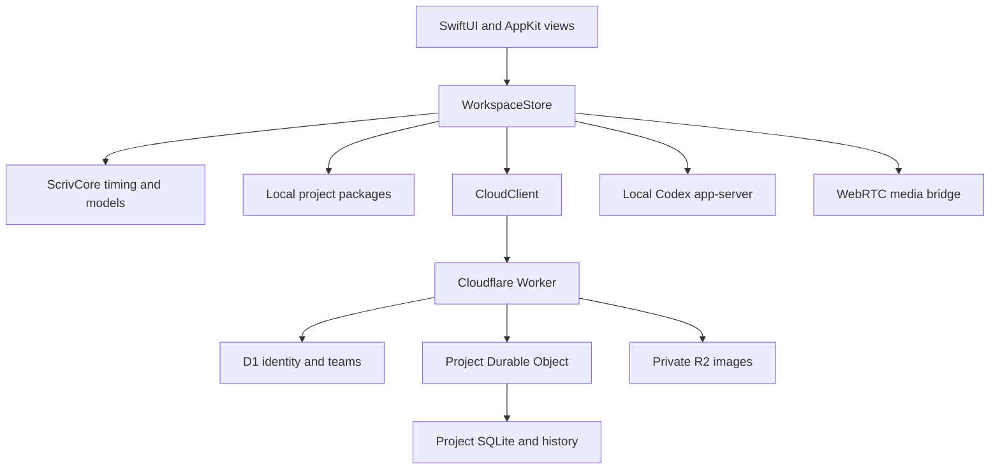

# Scriv application structure

This is the source map of the new Scriv application, not the inherited Movie AI Workspace. Paths are relative to the repository root. Product behavior is specified in [docs/design.md](docs/design.md); the implementation protocol is [docs/cloud-api.md](docs/cloud-api.md). Actual verification is recorded separately in [docs/verification.md](docs/verification.md).

## 1. Runtime boundaries

The Mac app owns the editing experience, local projects, playback and local generation. ScrivCore holds portable model and timing rules. Cloudflare owns accepted shared state, identity, membership and subscription entitlements. Image metadata belongs to project state; image bytes live locally, transfer over WebRTC, or use a paid R2 replica. Codex credentials never belong to the cloud service.

## 2. Top-level files and directories

| Path | Responsibility |
| --- | --- |
| `README.md` | Product overview, run commands, account separation and current release status. |
| `LICENSE` | MIT license for the rebuilt application. |
| `package.json`, `package-lock.json` | Root verification commands and the pinned Playwright test dependency. The UI is not a Node application. |
| `apps/mac/` | Native Swift package, app metadata, resources and core tests. |
| `cloud/` | Cloudflare Worker, D1 migration, Durable Objects, billing/media integrations and runtime tests. |
| `scripts/` | Repository verification, native packaging, icon generation and notarization. |
| `tests/` | Design-fixture invariants and actual browser WebRTC integration tests. |
| `design/` | Immutable conversation images, preservation manifest and exact timing fixture. |
| `docs/` | Current product/architecture/API/deployment/verification documents plus historical plans. |
| `.github/workflows/verify.yml` | Linux cloud/peer tests and macOS compilation, packaging and screenshot capture. |
| `.gitignore` | Excludes dependencies, generated builds, local project packages and credentials. |

## 3. Native app packaging

| File | Responsibility |
| --- | --- |
| `apps/mac/Package.swift` | Defines the portable `ScrivCore` library and its tests. On macOS also defines the `Scriv` executable / `ScrivApp` target with bundled resources. macOS deployment target is 14. |
| `apps/mac/Info.plist` | Bundle identity/version, default cloud URL, document-package type, `scriv://` deep links, icon and local-network description. |
| `apps/mac/Scriv.entitlements` | Direct-distribution entitlement file. Scriv can launch an installed local Codex process; this is not an App Store sandbox target. |
| `apps/mac/Sources/ScrivApp/App.swift` | Application entry point, window setup, menu commands, Settings scene, pending-save flush on termination, and `--screenshots` native capture mode. |

The distributed bundle contains `Contents/MacOS/Scriv`, `Contents/Info.plist`, `Contents/Resources/AppIcon.icns` and `Contents/Resources/Scriv_ScrivApp.bundle`. `ResourceBundle.swift` locates that embedded resource bundle instead of depending on a SwiftPM build-directory path.

## 4. Portable core: `apps/mac/Sources/ScrivCore/`

| File | Responsibility |
| --- | --- |
| `Models.swift` | Project, scene, script entry, timed word, character, image version and image cue value types; active entry/cue lookup and shared errors. |
| `TimingEngine.swift` | Script validation; duration/coverage changes; text-to-word updates; cue splits/cuts and contiguous edge-word transfer. Preserves sequence and reference invariants. Entry insertion, removal and movement are coordinated by `WorkspaceStore`. |
| `SampleProject.swift` | Empty-project factory and the farm-scene sample, stable example IDs, relative word times and cue boundaries. |
| `Fountain.swift` | Fountain/plain-text import and Fountain export, including speaker/scene/direction conversion. |
| `ProjectRepository.swift` | Atomic project package reads/writes, complete local history, project export, media import and digest validation, and durable canonical cloud checkpoints. |
| `CloudModels.swift` | Codable JSON values, cloud users/teams/projects/items/events, leases, presence, discussions, signals, and conversion between native project models and generic server items. |
| `CloudReconciliation.swift` | Three-way item reconciliation of the saved canonical cloud checkpoint, local draft and current remote state. Conflicting edits remain explicit. |
| `Digest.swift` | Portable SHA-256 and PKCE helpers, used by project media and identity flows. |

### Core model relationships

`ScrivProject` contains ordered scenes, entries, characters, versioned image assets and timed cues. Each entry belongs to one scene. A dialogue entry may reference a character; its words retain stable IDs and times relative to that entry. A cue references one image version and has its own start/end in the scene. An image has a content digest and editable character tags; its image bytes retain their immutable version identity. Regenerating creates a new asset/version rather than overwriting previous media references.

Entry start times are derived by accumulating **owned duration** in scene order. Direction coverage is measured from its own start and can extend forward over later entries. It never moves the sequence clock. This distinction is enforced in both the portable timing engine and server validation.

## 5. Native services: `apps/mac/Sources/ScrivApp/Services/`

| File | Responsibility |
| --- | --- |
| `WorkspaceStore.swift` | Main-actor observable workspace: selection, tabs, local state, playback clock, undo/redo, project open/save/import/export, editing leases, serialized local/cloud saves, reconciliation, generation attachment, peer discovery, media recovery, discussions and history. |
| `CloudClient.swift` | HTTPS API client, GitHub OAuth PKCE, origin-scoped Keychain sessions, per-client editor session, server-issued device identity, lease renewal, durable command outbox, atomic bootstrap, WebSocket/replay/reconnect, history/message pagination, media and team/billing requests. |
| `CodexController.swift` | Owned `codex app-server` process or explicit loopback WebSocket connection; JSON-RPC initialization, account login/logout, model listing, thread/turn generation, progress, cancellation and actual output-file validation. |
| `InternetPeerMedia.swift` | Native boundary around a nonpersistent headless WKWebView. Authorizes hashes for the current project, passes signaling through CloudClient, supplies local bytes and verifies received bytes before importing them. |
| `NativePeerSmoke.swift` | `--peer-smoke <directory>` verification mode: two actual WKWebView bridges transfer a bundled multi-chunk PNG over WebRTC, then verify byte equality and SHA-256 with a 45-second deadline. Signaling stays in memory; no cloud account is used. |
| `ResourceBundle.swift` | Resolves resources for both `swift run`/development and a packaged `.app`. |

There are two independent session identities: the cloud-authenticated device ID is issued by the server; the editing session ID identifies one native client for lease fencing. A client cannot choose another device's signal inbox. The outbox and canonical checkpoints are scoped to their project, account and API origin so changing endpoints cannot replay another server's edits or credentials.

## 6. Native views: `apps/mac/Sources/ScrivApp/Views/`

| File | Responsibility |
| --- | --- |
| `Theme.swift` | Shared colors, type, surfaces, spacing and compact control treatments. |
| `WorkspaceView.swift` | Main native shell, project menu, view switching, account/Codex controls, sheets and discussion placement. The scene picker is in the script header. |
| `ScriptEditorView.swift` | One aligned script column; dialogue/direction rows, speaker links, editable text, durations, forward-only direction coverage rails and overlapping-range selection. |
| `LiveScriptTextEditor.swift` | AppKit `NSTextView` bridge for real text editing, actual UTF-16 selection/caret anchors and live presence publication. |
| `PreviewPane.swift` | Selected/playing image preview, generation/import/recovery controls and playback affordances. |
| `LayerTimelineView.swift` | Images/dialogue/directions/words tracks, overlapping direction lanes, playhead, seek and shared cue-boundary manipulation. |
| `StoryboardView.swift` | Full-width timed image cards, duration controls, selectable word pills, rectangular marquee selection, contiguous edge-word transfer to adjacent images and direction bands. |
| `CharactersView.swift` | Character selection and editing, aliases, appearance/biography, portrait choice, image tags and version gallery. |
| `DiscussionPanel.swift` | Project/item thread contexts, replies, exact-version image attachments, draft retention, resolution and participant display. |
| `MediaComponents.swift` | Asynchronous local image loading/display, linked character text, timed word highlighting, collaborator selection/caret rendering and shared image/text presentation pieces. |
| `AccountAndCodexViews.swift` | Separate Scriv and Codex account panels, local runtime controls, model selection, generation progress/cancellation and app settings. The generation prompt is in `PreviewPane.swift`. |
| `ProjectAndHistoryViews.swift` | Local/cloud project browser, saved revision timeline, cloud events and restore actions. |
| `TeamSheet.swift` | Team creation/selection, subscription checkout/portal, member roles, reusable invitation links and access management. |

All views use the same WorkspaceStore and stable model IDs. Selecting a linked name opens its character. Selecting an image discussion anchors to that image version. Playback selects the current image/word without modifying the stored script. A word drag moves a contiguous suffix to the next image or a contiguous prefix to the previous image; it never moves unselected intervening words. The bundled sample starts at zero, while the preserved design fixture retains the original full-scene offsets.

## 7. App resources: `apps/mac/Sources/ScrivApp/Resources/`

| Path | Responsibility |
| --- | --- |
| `PeerTransfer/bridge.html` | Minimal local document with a restrictive content policy; hosts the headless WebRTC transport. |
| `PeerTransfer/bridge.js` | Offer/answer and ICE negotiation, simultaneous-offer handling, negotiated data channel, chunking/backpressure, transfer/request limits and SHA-256 checking. It has no Scriv bearer token. |
| `SampleImages/farm-wide.png` | Generated wide farm-scene frame used by the bundled sample. |
| `SampleImages/franklin.png` | Generated Franklin close-up. |
| `SampleImages/miyazaki.png` | Generated Miyazaki close-up. |
| `SampleImages/provenance.json` | Sample-image generation descriptions, source names and byte digests. |
| `README.txt` | Resource-bundle notes. |

## 8. Cloud application: `cloud/src/`

| File | Responsibility |
| --- | --- |
| `index.ts` | Public Worker entry point, routing, health/config endpoints, authentication boundary, project-DO dispatch, hourly cleanup and billing/media reconciliation. Exports both Durable Object classes. |
| `types.ts` | Worker bindings, secret/variable contract, identities, membership roles, database rows and item/event shapes. |
| `http.ts` | Structured errors, bounded body readers, validators, cryptographic tokens/digests, stable serialization, origin handling and rate limits. |
| `auth.ts` | GitHub OAuth, one-time PKCE exchange, hashed session issuance, logout, device-session listing/revocation. No development login bypass. |
| `access.ts` | Session verification, team roles, paid entitlements, project permissions, archived/downgraded-project access and public response shapes. |
| `teams.ts` | User/team/project catalog, membership changes, reusable invitation links and browser-to-app join page. |
| `project-room.ts` | One SQLite Durable Object per project: snapshots, atomic commands/import, fenced edit leases, replayable history/restore, threads/messages, WebSocket presence/events, peer signaling and access refresh. |
| `validation.ts` | Server item schemas and allowed kinds; finite timing/duration checks, required references and word/image/character constraints. |
| `billing.ts` | Team-scoped billing coordinator; one $9.99 monthly Stripe subscription, owner checkout/portal, signature verification, webhook deduplication and canonical subscription reconciliation. |
| `media.ts` | Authorized private R2 upload/download/delete, body digest/type/size checks, quota reservation/recovery, authorized device discovery and short-lived TURN issuance. |
| `notifications.ts` | Revocation/entitlement refresh fan-out into affected project rooms after membership, session or billing changes. |

### Cloud configuration and persistent schema

| Path | Responsibility |
| --- | --- |
| `cloud/wrangler.jsonc` | Worker entry, compatibility date, variables, D1/R2 bindings, SQLite Durable Object migrations, hourly cron and observability. The committed D1 ID and public hostname are deliberate deployment placeholders. |
| `cloud/.dev.vars.example` | Names of required/optional local provider credentials without credential values. |
| `cloud/migrations/0001_identity_teams.sql` | D1 tables, indexes and atomic asset quota triggers. |
| `cloud/package.json`, `cloud/package-lock.json` | Pinned Cloudflare/TypeScript/Vitest toolchain and dev/test/dry-run/deploy commands. |
| `cloud/tsconfig.json` | Strict TypeScript configuration for the Worker. |
| `cloud/vitest.config.ts` | Workers runtime test bindings, migrations and opt-in load-test selection. |
| `cloud/README.md` | Backend development and provider setup. |

D1 tables are `users`, `sessions`, `oauth_states`, `auth_codes`, `teams`, `team_members`, `join_links`, `projects`, `billing_events`, `assets` and `security_limits`. A project room's SQLite tables are `schema_migrations`, `meta`, `items`, `leases`, `events`, `changes`, `receipts`, `threads`, `messages` and `signals`. The billing coordinator also keeps idempotent checkout state in Durable Object storage. The [architecture document](docs/architecture.md) explains ownership and transaction boundaries.

## 9. Tests and automation

| Path | What is verified |
| --- | --- |
| `apps/mac/Tests/ScrivCoreTests/TimingTests.swift` | Forward direction overlap, zero-time insertion, sequence changes, cue boundary conservation, word transfer and validation. |
| `apps/mac/Tests/ScrivCoreTests/PersistenceTests.swift` | Package/history round trips, byte integrity, cloud JSON conversion and digest behavior. |
| `apps/mac/Tests/ScrivCoreTests/ReconciliationTests.swift` | Independent-edit merges, same-item/timing conflicts, deletion/tombstones, durable account/origin-scoped checkpoints and server-computed paid status. |
| `apps/mac/Tests/ScrivCoreTests/FountainTests.swift` | Script import/export behavior and malformed-input limits. |
| `cloud/tests/backend.test.ts` | Actual Workers/D1/DO/R2 behavior: authentication/permissions, leases, concurrency, history, discussion, membership, billing, images, import and revocation. Stripe/GitHub external requests use controlled provider responses. |
| `cloud/tests/load.test.ts` | Opt-in test with 500 distinct authenticated members/sockets and 100 concurrent independent writers, including presence and mutation delivery counts. |
| `tests/design-fixture.test.mjs` | Precise accepted timing example, word order and direction/owned-time invariants. |
| `tests/peer-transfer.browser.mjs` | Real browser-to-browser data channels, multi-chunk image transfer, simultaneous requests, hash validation and explicit missing/invalid asset failure. |
| `scripts/check-repo.mjs` | All original image and sample-frame hashes, timing references and expected release files. |
| `scripts/check-codex-contract.py` | Optional local validation of the native client's contract fixtures against schemas generated by the official Codex executable. |
| `tests/fixtures/codex-0.165.0.json` | Fifteen valid app-server request/response fixtures and three negative contract regressions. |
| `scripts/verify.sh` | Cloud typecheck/runtime tests/dry-run, repository/fixture checks, and Mac core/package checks when run on macOS. |
| `scripts/build-mac.sh` | Native release/debug build, optional universal binary, bundle resources/icon/metadata, signing validation and ZIP packaging. |
| `scripts/make-icon.swift` | Produces the native iconset used by `iconutil`. |
| `scripts/notarize-mac.sh` | Requires an existing Developer ID build and notary Keychain profile; submits, staples, validates and repackages the app. |
| `.github/workflows/verify.yml` | Separate cloud, browser peer and native Mac jobs. The Mac artifact includes the ZIP and three screenshots from actual native views. |

## 10. Design and documentation

| Path | Responsibility |
| --- | --- |
| `design/images/01-script-editor.png` | Approved main script/layered editor concept. |
| `design/images/02-characters.png` | Approved Characters concept. |
| `design/images/03-storyboard.png` | Approved full-width Storyboard concept. |
| `design/images/04-collaboration-local-codex.png` | Discussion, account and local-runtime concept. |
| `design/archive/` | The earlier 21 image iterations, `README.md` catalog and bundle notes. |
| `design/manifest.json` | Exact original filenames, dimensions, byte counts and SHA-256 hashes for all 25 preserved images. |
| `design/storyboard-timing-example.json` | Exact sample timings, words, cues and direction coverage used to validate interpretation of the mockups. |
| `docs/design.md` | Current interaction specification. |
| `docs/architecture.md` | Current schema and synchronization design. |
| `docs/cloud-api.md` | Executable native/server API contract. |
| `docs/deployment.md` | Deployment-agent handoff and release gates. |
| `docs/verification.md` | What was tested, measured results and unexecuted production checks. |
| `docs/backend-verification.md` | Exact Worker integration/load results and capacity/latency limits. |
| `docs/codex-integration.md` | Tested app-server version, verified contracts and reproducible schema-check commands. |
| `docs/verification/codex-0.165.0.json` | Preserved result of the 18 official-schema contract checks. |
| `docs/build-progress.md` | Implementation checkpoint history. |
| `docs/multiplayer-design.md` | Historical Postgres/Redis proposal, explicitly superseded by Cloudflare/$9.99-per-team decisions. |

## 11. Data paths and lifecycle

Local projects are `.scriv` directory packages. `project.json` contains the current canonical native model, media files live inside the package, and saved revisions retain project snapshots for restoration. The repository code validates content and image paths rather than interpreting project filenames as arbitrary filesystem destinations. Export copies a complete project package; Fountain export is the script-only interchange format.

An ordinary edit runs through `WorkspaceStore` and `TimingEngine`, saves a local revision, then sends a cloud command when attached. Existing shared items require a lease, expected item version, project epoch and timing version. The room commits items, change records and the idempotent receipt atomically before live notification. Remote clients can recover missed notifications from the durable sequence log.

Generation takes a snapshot of the target, uses a fresh local directory, and imports a real validated output as a new image asset. A late result cannot silently replace a newer target edit. The native media bridge only serves hashes authorized for the currently open project. Paid hosted copies have their own D1/R2 lifecycle and do not change script timing or image identity.

Generated build/dependency directories and actual user projects are deliberately absent from Git. Cloudflare resources, OAuth/Stripe/TURN secrets, Apple signing credentials and the user's local Codex account are environment configuration, not source files.
