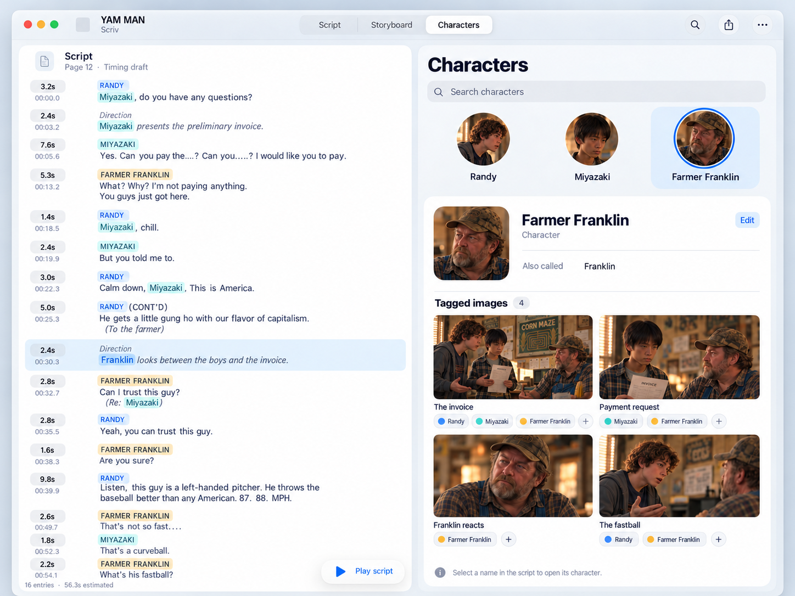
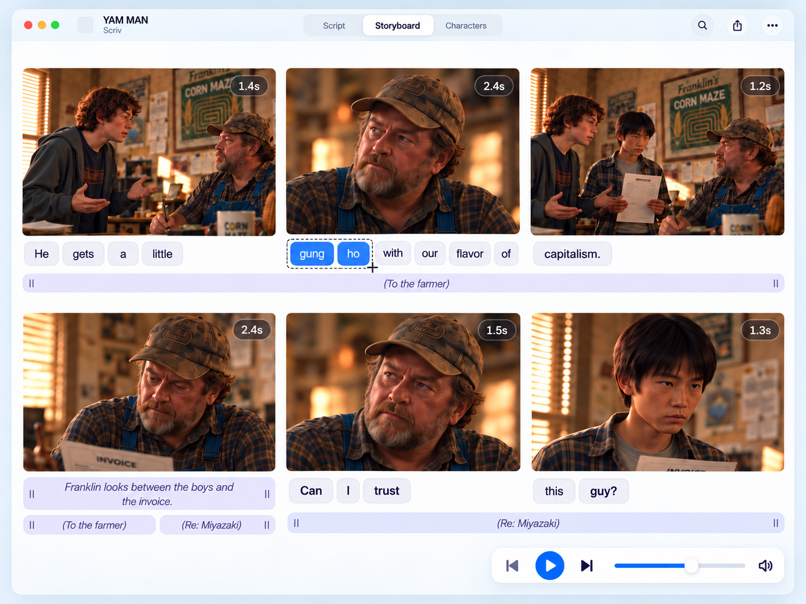
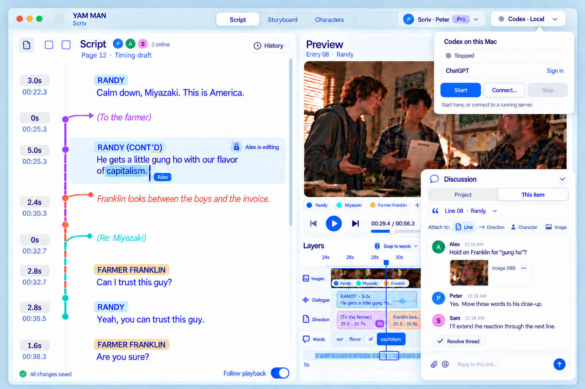
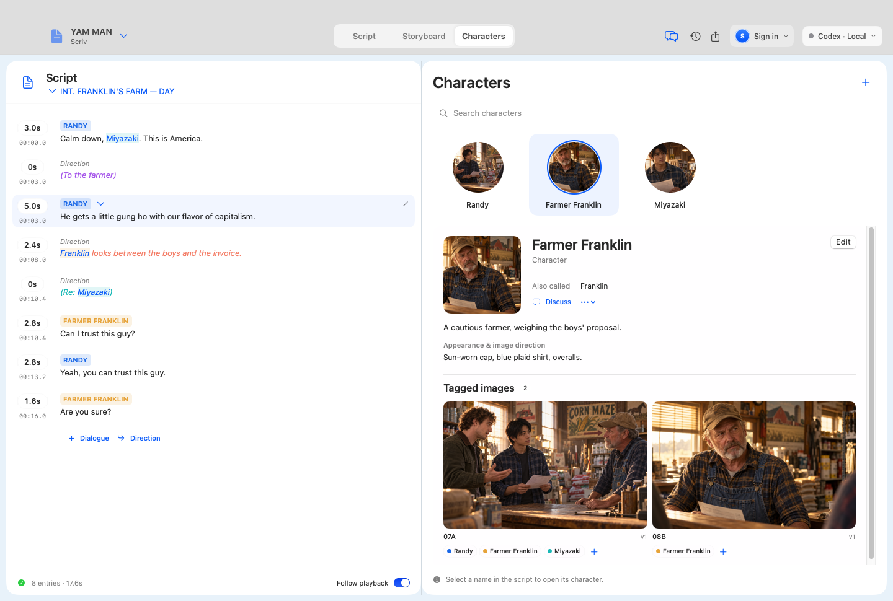
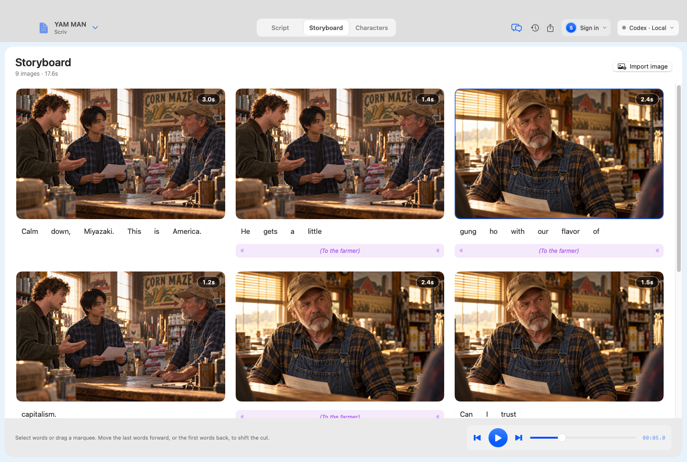

# Scriv — conversation transcript and complete work record

**Archived:** October 29, 2026.

**Repository:** [pcopu/scriv](https://github.com/pcopu/scriv), public, branch `main`.

**Requested filename:** `transcript.MD`.

**Repository head inspected before this addition:** [`f7382ee049a92a6610ee3182f3786c1354be3c4a`](https://github.com/pcopu/scriv/commit/f7382ee049a92a6610ee3182f3786c1354be3c4a).

**Original implementation handoff:** [`cc95e945f6abfd5a116b94920ca8827155aded90`](https://github.com/pcopu/scriv/commit/cc95e945f6abfd5a116b94920ca8827155aded90).

**Verified application runtime:** [`0eb779b8e07935235d4584b09abe05bd0504be01`](https://github.com/pcopu/scriv/commit/0eb779b8e07935235d4584b09abe05bd0504be01).

## How to read this archive

The user requested a transcript of the entire conversation and everything done during it. This file preserves **all 41 user messages available in the conversation context, in order**, the recoverable final assistant response, the complete preserved design-image sequence, and a detailed evidence-linked record of the research, repository audit, design, implementation, debugging, testing, commits, and handoff.

**This is not a complete verbatim platform export.** Many earlier assistant replies, their exact image-generation prompts, and individual progress updates were no longer available as original messages when this archive was requested. A search of the earlier conversation recovered summaries and a few exact passages, not the missing full message bodies. Those gaps are explicitly represented by **reconstructed work records**, never invented assistant quotations. Exact user spelling, capitalization, and wording are retained; Markdown blockquote formatting is added and line-end whitespace normalized for readability. Message numbers identify order, not original platform IDs. Dates are provided only where supported by Git, CI, or a recovered record.

The original interface images are preserved in the repository and linked below. Their exact bytes and generation filenames survive even where the surrounding assistant text does not. Technical tool activity is summarized by outcome and evidence rather than reproduced as an unfiltered terminal log. The later portable-verification commit already on `main` is recorded separately; this archive does not attribute its originating conversation to this chat.

Commit times below use **America/New_York (EDT, UTC−04:00)**. Machine-readable verification files retain their explicit UTC timestamps. This document is a historical record through the transcript request; later product changes belong in their own commits.

## Contents

1. [Conversation in order](#1-conversation-in-order)
2. [Decisions and their evolution](#2-decisions-and-their-evolution)
3. [All visual artifacts](#3-all-visual-artifacts)
4. [Research and original repository audit](#4-research-and-original-repository-audit)
5. [What was built](#5-what-was-built)
6. [Problems found and corrections made](#6-problems-found-and-corrections-made)
7. [Commit history](#7-commit-history)
8. [Verification and build artifacts](#8-verification-and-build-artifacts)
9. [Deployment handoff and remaining acceptance](#9-deployment-handoff-and-remaining-acceptance)
10. [Archive creation and source index](#10-archive-creation-and-source-index)

## 1. Conversation in order

### Phase A — finding a shared, script-first starting point

### User 01 — verbatim

> is there a script storyboard tool out there using codex app server to run image gen

### User 02 — verbatim

> like a central tool that multiple people can use it

### User 03 — verbatim

> find me pics of this [Movie AI Workspace](https://github.com/linkprint/local-ai-movie-workspace)

### User 04 — verbatim

> It needs to be script first

### User 05 — verbatim

> maybe we start with storyboard

### User 06 — verbatim

> I want to create a different version but it could be a good start - fork it I guess and keep it open

### User 07 — verbatim

> public

### User 08 — verbatim

> I'm already connected brop

**Assistant/work record — reconstructed.** Earlier research discussed Boords, Cozy Studio, Agent Storyboard, and Movie AI Workspace. The search did not establish a finished shared product with the exact requested Codex app-server workflow. The conversation narrowed to a public fork and a script-first product. The user explicitly said the GitHub connection already existed. The actual fork operation is not evidenced by an assistant commit; the user's next message reports that it was done. See [research and audit](#4-research-and-original-repository-audit).

### User 09 — verbatim

> ok done - forked as scriv - we're going to basically do scrivener but for every line we can time imagegen and play it back as the timed script plays out

**Assistant/work record — reconstructed.** The project was named **Scriv**. Its core idea became a writing application in which authored script units carry timing and image cues, and playback follows the script and images together. The resulting repository was the public [pcopu/scriv](https://github.com/pcopu/scriv).

### Phase B — inspect the fork and document its structure

### User 10 — verbatim

> wanna do imagegen of the new interface before you do anything

### User 11 — verbatim

> first look over the code and make of structure.md of everything

### User 12 — verbatim

> DUDE

### User 13 — verbatim

> Look over the repo scriv using the github connector already connected and create a structure.md and commit that completely covers the structure of the app

**Assistant/work record — reconstructed from a committed deliverable.** The inherited repository was inspected and a comprehensive `structure.md` committed to `main` at [`a983e4a`](https://github.com/pcopu/scriv/commit/a983e4ae8cbc96be7cc70e2963f93bd5459abe4f). The audit covered 110 tracked files, 31 bundled duplicates, the data model, routes, 15 MCP tools, generation, audio/timing, persistence, configuration, tests, and gaps relative to Scriv. It identified the actual inherited upstream as `Yuuhann1999/agent-storyboard` and the image adapter as `codex exec`, not an app-server integration. The original audit remains available [at that commit](https://github.com/pcopu/scriv/blob/a983e4ae8cbc96be7cc70e2963f93bd5459abe4f/structure.md). The current [structure.md](structure.md) maps the replacement application.

### Phase C — the Mac editor, direction, characters, and visual style

### User 14 — verbatim

> Give me some scrivener inspired Mac app image gen

### User 15 — verbatim

> Left is the script and on the right is a video timeline that you can play back and follow along the timed words and script

### User 16 — verbatim

> Need direction too for timing and such like Jason turns to the left. So every line has duration on the left and can be script or direction. If script under it there can be direction in smaller font. Like “you stupid guy!”
> Then in direction font ut says Jason turns to Bonny with anger in his eyes as he raises one hand to hit her

### User 17 — verbatim

> Do a page of this scene to make sure our structure works for what I want to do.

**Assistant/image record — reconstructed.** Generated concepts explored a manuscript-first Mac workspace, light and dark treatments, dialogue with smaller attached direction, and a **YAM MAN page 12** example. The exact scene attachment and full image-generation response text are not available as transcript text here. The surviving images are iterations 1–7 in the [image ledger](#3-all-visual-artifacts); the authored timing example survives separately in [design/storyboard-timing-example.json](design/storyboard-timing-example.json).

### User 18 — verbatim

> Ok indtead of timeline we need characters. And highlight each name in the script that links to the character inside the character tab and every image that has that character in it is tagged as well

### User 19 — verbatim

> Make it more Mac-y

### User 20 — verbatim

> Yeah not quite. Think uikit

### User 21 — verbatim

> Good now do the main view with uikit

### User 22 — verbatim

> Good but I liked the layered editor better

**Assistant/image record — reconstructed.** The design moved through a dark character inspector, a lighter character list, and the selected Characters concept. Names and aliases became links to shared profiles, and images gained depicted-character tags. The main workspace was redrawn in the requested Mac/UIKit-inspired style, then returned to the layered editor after the user preferred that arrangement. The earlier approved layered editor is [iteration 12](design/archive/12_main_layered_editor_earlier_approved.png); the selected character view is [iteration 10](design/images/02-characters.png). These are image concepts, not screenshots of an app already running at that point.

### Phase D — a dedicated storyboard and independently timed words

### User 23 — verbatim

> Good bundle the 2 we have and like and then do  a dedicated storyboard full width view that has thumbs and text underneath every item allow each line item to span multiple images if that single line has multiple images timed

### User 24 — verbatim

> Take another stab at this one. Simplify maybe a bit to remove characters put time length in a pill over top?
>
> Remove just most of it and focus on the images and text and length of each allow length to be drug right or left to take up the prev or next. Also allow selection of words or single and allow user to drag into the next or prev image to change when those happen

### User 25 — verbatim

> Kind of but allow selection of individual words with a photoshop like selector and then they highlight. Maybe each word is like a pill and underneath that is the overlapping direction if any

**Assistant/image and artifact record — reconstructed.** A design bundle was assembled with the selected main/Characters views and the evolving storyboard. The storyboard was simplified into large frames, duration pills over the images, individual spoken-word pills beneath, and direction bands below the words. The bundle's surviving explanatory text is [design/archive/bundle-notes.md](design/archive/bundle-notes.md). The grouped-line, word-drag, and word-pill concepts are iterations 13–15. One script item can have multiple images; moving a cut redistributes time between adjacent images without changing the sequence's total duration.

### Phase E — resolving direction overlap and returning to one script column

### User 26 — verbatim

> On the other view too I think we need 2 columns one for direction and one for spoken word so we can have those timed separately

### User 27 — verbatim

> No go back to the og and maybe the left part of the line can extend up/down to show overlap.

### User 28 — verbatim

> Yeah perfect but those directions only have extending vertical things and can have 0s in and of themselves or can have timeline space of their own

### User 29 — verbatim

> I think direction can only overlap after itself

### User 30 — verbatim

> Yeah good but all line items should be left aligned and then we have multiple lanes for any overlaps. And we can have the top curve and point to the line it goes to

### User 31 — verbatim

> Maybe they overlap and fake the same vertical row but have different colors?

### User 32 — verbatim

> Yeah good now show me the final 3 views

**Assistant/image and timing record — reconstructed.** The separate direction/speech columns were superseded. The agreed implementation uses one left-aligned script flow and distinguishes **owned duration** from **forward coverage**. Only a direction has a vertical coverage control. Its top is fixed to its authored position, curves into an arrow pointing to its source line, and its lower endpoint changes the forward extent. Multiple directions share a colored gutter rail. A zero-second direction can cover later speech without adding sequence time; a positive-duration direction can own an action slot and continue beyond it. The design sequence is preserved in iterations 16–23. The three main views are Script, Characters, and Storyboard. Exact interaction rules and timings were recorded in [docs/design.md](docs/design.md) and the [timing fixture](design/storyboard-timing-example.json).

### Phase F — multiplayer, discussion, billing, and local Codex

### User 33 — verbatim

> Ok also I want simple db schema thought through. Will support a redis for hundreds of live multiplayer where you can see the other persons cursor just like in Google Docs. Full history timeline. Live db read write. That is a premium feature if you sub to stripe 10/m. Script storage is free on free but images will be sent from p2p to sync machine to machine. We will use that on premium too the redis or some such to keep things absolutely streaming live when someone makes a change. When someone is on a script line it locks out the other people and we have a small chat bottom right that allows annotation of characters lines direction or even images with a running thread per item too. Image gen the chat and store this in an Md.
>
> Multiplayer and image storage are premium but just single person usage is free. So we need top right  sign in thing. 2 sign in’s. Sign into the app and sign in with chatgpt to run the image gen and whatever else

### User 34 — verbatim

> Wait doesn’t support image gen? Then just have the local Mac app use the codex server. Start/stop and connect I guess?

**Assistant/work record — reconstructed.** A multiplayer design was written and committed as [`bab1928`](https://github.com/pcopu/scriv/commit/bab19289916005740fc8a50b93525e4453ea6cdb), with two collaboration concepts: before and after adding local Codex controls. The original proposal used Postgres, Redis/WebSockets, item locks, cursor presence, append-only history, stable item threads, P2P images and paid hosted replicas. It distinguished the Scriv identity from local Codex/ChatGPT authentication. The discussion corrected the assumption that a generic hosted Sign in with ChatGPT path itself supplied the required image-generation service: the chosen integration was the user's **local Codex app-server**, managed from the Mac app. Exact earlier assistant wording is unavailable; the preserved plan is [docs/multiplayer-design.md](docs/multiplayer-design.md). Its original $10/Redis/Postgres proposal is explicitly historical and was later superseded.

### Phase G — replace the inherited code and finish the whole product

### User 35 — verbatim

> I think we should just wipe the old code we pulled from whatever that other app is this is a completely different app.
>
> Just keep the stuff we made up in this chat the images and the plan

### User 36 — verbatim

> Go ahead and build the app in its entirety. The Mac app, the redis and db structure around cloudflare 5/m plan since I have that already
>
> I want the entire thing done and ready after this next turn finishes. No shortcuts. Full parity with uikit to what the images show like 1:1 but cleaner obv since images get a few things wrong. I mean straight up ready to go outside of deployment obv stripe is 9.99 per team and you can invite tons of folks to your projects. If you have team anyone can join your team
>
> Don’t stop until it’s literally ready to hand over to an agent to push everything live

### User 37 — verbatim

> Did you finish?

### User 38 — verbatim

> As you’re working you need be committing as often as you can please

### User 39 — verbatim

> you need to commit and finish this project

**Assistant/work record — reconstructed from code, commits, and verification artifacts.** The inherited implementation was replaced with a new native SwiftUI/AppKit Mac app and Cloudflare backend. All 25 conversation concept images, the timing fixture, and the plans were retained; the old code remains in Git history. Work was divided across native core/services, interface, backend, protocol audit, and integration/verification. Frequent checkpoints were committed to `main` rather than leaving the finished work only in a local checkout.

The completed implementation includes Script/Characters/Storyboard, timing and playback, local packages/history, source-safe generation, the local Codex lifecycle, separate cloud authentication, team membership and billing, exclusive item edit leases, live cursor/selection presence, per-item discussion, cloud history/restore, P2P media, premium private R2 replicas, tests, universal Mac packaging, real native screenshots, and deployment documentation. Subsequent integration work corrected offline reconciliation, history immutability, actual Codex request contracts, native control placement, and WebRTC negotiation/retry races. Detailed records appear in [what was built](#5-what-was-built), [corrections](#6-problems-found-and-corrections-made), and [verification](#8-verification-and-build-artifacts).

The final runtime commit `0eb779b` passed cloud, browser peer-transfer, and native Mac CI. The documentation/capture handoff was `cc95e94`. A full earlier long-form completion response is not recoverable verbatim here; its facts are represented by the committed handoff and verification evidence.

### Phase H — completion status and this archive

### User 40 — verbatim

> Did it finish?

### Assistant — recovered final response

> **Yes. It finished, and everything is committed to `main`.** I just checked GitHub again.
>
> - **Latest commit:** [cc95e94 — final handoff and verified screenshots](https://github.com/pcopu/scriv/commit/cc95e945f6abfd5a116b94920ca8827155aded90)
> - **Final build:** [Completed successfully](https://github.com/pcopu/scriv/actions/runs/40921544866). Cloud tests, browser image-transfer tests, native Mac compilation, universal packaging, and the native WebKit transfer test all passed.
> - **Mac app:** [Download the build artifact](https://github.com/pcopu/scriv/actions/runs/40921544866/artifacts/12918682797)
> - **Next agent’s instructions:** [Deployment handoff](https://github.com/pcopu/scriv/blob/main/docs/deployment.md)
>
> The implementation is ready for deployment handoff. The remaining steps are production account configuration, signing/notarization, and live-account acceptance checks, as documented.

**Archive context.** This response reported the branch and successful runtime build checked at the time. A later verification-script commit, `f7382ee`, was discovered when preparing the transcript and is preserved in the history below. It changes verification tooling, not the application runtime. The response above remains a historical quotation rather than a claim that `cc95e94` will always be the current branch head.

### User 41 — verbatim

> Create a transcript of this entire chat and everything we did and put it in transcript.MD on main please

**Assistant/work record — this archive.** Earlier conversation retrieval, local repository records, the preserved images, and GitHub history were checked. The newer `f7382ee` verification commit was fetched and preserved. This file collects the available exact conversation and separates it from the reconstructed work history. Publication of this archive adds documentation to `main`; it does not deploy Scriv.

## 2. Decisions and their evolution

| Topic | Earlier request or proposal | Final implemented direction |
| --- | --- | --- |
| Product starting point | Find a central Codex-backed storyboard tool; consider Movie AI Workspace. | Public Scriv fork, followed by a new application after the user directed removal of the inherited code. |
| Core workflow | Start with storyboards, but require script-first authoring. | Stable authored entries are authoritative; images, words, direction, playback, and discussions attach to shared identities. |
| Mac style | Scrivener-inspired, then more Mac-like, then “Think uikit.” | Native SwiftUI/AppKit UI with the requested Apple-style surfaces and layout; UIKit was the visual reference, not the macOS implementation framework. |
| Main view | Script left, timeline right; later explore Characters instead. | Separate Script, Characters, and Storyboard views. Script keeps the image preview and layered editor. |
| Dialogue/direction layout | Smaller direction under dialogue, then two independent columns. | One continuous left-aligned authored flow. Separate columns remain an archived experiment. |
| Direction timing | Extend line controls up/down; possible overlaps. | Forward-only coverage from the direction's authored position, with a fixed top and a draggable lower end. |
| Direction duration | Direction can be 0s or own timeline space. | Owned duration and coverage are different fields. Coverage adds no sequence time. |
| Overlap display | Separate lanes with a curved source pointer. | Colored/interleaved coverage ranges on a common gutter rail, fixed curved source arrows, selection handling for coincident ranges. |
| Storyboard detail | Thumbnails and text below each item. | Large image cards, overlaid duration pills, individual word pills, direction bands, minimal metadata. |
| Word editing | Select one or several words with a Photoshop-like selector; drag to adjacent frames. | Rectangular marquee; contiguous edge-word moves change the adjacent cut while preserving word order and timestamps. |
| Image timing | Each line may span several generated images. | Entries and image cues have separate stable identities; one entry can have several cues and one cue can span entries. |
| Characters | Highlight names and connect them to a Characters tab; tag images. | Stable profiles with aliases; linked mentions; explicit depicted-character tags; immutable image versions. |
| Multiplayer | Hundreds of users, visible cursors, line locking, streaming edits. | Authenticated WebSocket project rooms, real cursor/selection presence, exclusive renewable item leases, version/fence/epoch validation and durable replay. |
| Coordination backend | Redis or similar, with an initial Postgres proposal. | Cloudflare SQLite Durable Objects coordinate projects; D1 holds identity/catalog/billing; a separate Redis/Postgres service is unnecessary. |
| Subscription | Initial “10/m” premium proposal. | **USD $9.99 per team per month**, no per-seat charge. |
| Membership | Anyone can join a subscribed team; invite many people. | Reusable authorized invitation links and role-based membership, without a billed seat count. Room connection limits still protect infrastructure. |
| Free plan | Single-person use and script storage free. | Local solo use, authenticated personal script/history sync, and authorized same-account P2P image transfer. |
| Premium media | Hosted image storage and multiplayer paid; P2P also used by premium. | Private authorized R2 replicas and team collaboration; local/P2P media paths remain available. |
| Discussion | Small bottom-right chat, threads per character/line/direction/image. | Project and item contexts with stable anchors, replies, resolution, and exact image-version attachments. |
| Account separation | App sign-in and ChatGPT sign-in. | GitHub OAuth for Scriv cloud identity; local Codex handles ChatGPT authentication and generation independently. |
| Local runtime | Start/stop/connect to Codex server. | Owned stdio child process or explicit loopback WebSocket connection; Stop applies only to a process Scriv started. |
| Completion scope | Entire app ready for another agent to push live, outside deployment. | Source, tests, native package, real screenshots, configuration templates and deployment handoff; production/account/signing gates remain explicit. |
| Work preservation | Commit as often as possible. | Incremental public commits for implementation, assets, integration, fixes, verification, handoff, and this transcript. |

The current behavior is described by [docs/design.md](docs/design.md), [docs/architecture.md](docs/architecture.md), and [docs/cloud-api.md](docs/cloud-api.md). Earlier bundle approval labels and the original multiplayer proposal are retained as historical artifacts; they should not override later decisions.

### The exact timing example carried through the design

These are editorial example timings, not measurements from a recorded performance. The preserved fixture uses full-scene offsets; the bundled playable excerpt starts at zero while retaining the relative durations.

| Authored item | Owned sequence time | Direction coverage |
| --- | --- | --- |
| “(To the farmer)” | 0s, positioned at 25.3s | 25.3–30.7s |
| Randy: “He gets a little gung ho with our flavor of capitalism.” | 5.0s, 25.3–30.3s | Speech has ordinary timing, not its own direction rail. |
| Franklin looks between the boys and the invoice. | 2.4s, 30.3–32.7s | 30.3–35.5s |
| “(Re: Miyazaki)” | 0s, positioned at 32.7s | 32.7–35.9s |
| Franklin: “Can I trust this guy?” | 2.8s, 32.7–35.5s | Speech has ordinary timing. |

The excerpt owns **10.2 seconds**: 5.0 + 2.4 + 2.8. Coverage through 35.9s does not extend runtime. The farmer note and reaction coverage intersect for 0.4s; reaction and Miyazaki coverage intersect for 2.8s. A direction cannot extend backward; moving its source earlier is the way to make it apply to earlier content.

The demonstrated “gung ho” move transfers 0.6s between neighboring image cues: 08A/08B change from **2.0s / 1.8s** to **1.4s / 2.4s**, moving the cut from 27.3s to 26.7s. The words retain their original timestamps and order. The final example assignments are:

| Cue | Range | Duration | Spoken words |
| --- | --- | --- | --- |
| 08A | 25.3–26.7s | 1.4s | He gets a little |
| 08B | 26.7–29.1s | 2.4s | gung ho with our flavor of |
| 08C | 29.1–30.3s | 1.2s | capitalism. |
| 09A | 30.3–32.7s | 2.4s | None; the reaction is unspoken direction. |
| 10A | 32.7–34.2s | 1.5s | Can I trust |
| 10B | 34.2–35.5s | 1.3s | this guy? |

Source: [timing fixture](design/storyboard-timing-example.json), [current interaction specification](docs/design.md), and [historical bundle notes](design/archive/bundle-notes.md).

## 3. All visual artifacts

### Original interface-generation sequence

All **25** original conversation concept images were retained without changing their bytes: **4 selected/current references and 21 archived iterations**, totaling **45,075,233 bytes**. The [preservation manifest](design/manifest.json) records each original generated filename, dimensions, byte count, SHA-256, iteration, title, and current/archive status. The table follows that recorded generation order; it does not fabricate a one-to-one mapping to unavailable assistant message IDs.

| Iteration | Preserved image | Status |
| --- | --- | --- |
| 01 | [Initial script-first workspace](design/archive/01_initial_script_first_workspace.png) | Archived iteration |
| 02 | [Mac manuscript with dark preview](design/archive/02_mac_manuscript_dark_preview.png) | Archived iteration |
| 03 | [Early light Mac editor](design/archive/03_mac_light_editor.png) | Archived iteration |
| 04 | [Early dark Mac editor](design/archive/04_mac_dark_editor.png) | Archived iteration |
| 05 | [Dialogue and attached direction](design/archive/05_dialogue_and_attached_direction.png) | Archived iteration |
| 06 | [Initial YAM MAN page 12](design/archive/06_yam_man_page12_initial.png) | Archived iteration |
| 07 | [YAM MAN with parentheticals beneath speech](design/archive/07_yam_man_parentheticals_below_speech.png) | Archived iteration |
| 08 | [Characters with dark inspector](design/archive/08_characters_dark_panel.png) | Archived iteration |
| 09 | [Characters with light list](design/archive/09_characters_light_list.png) | Archived iteration |
| 10 | [Current Characters view](design/images/02-characters.png) | Selected reference |
| 11 | [Main scene image gallery](design/archive/11_main_scene_image_gallery.png) | Archived iteration |
| 12 | [Earlier approved layered main editor](design/archive/12_main_layered_editor_earlier_approved.png) | Archived iteration |
| 13 | [Storyboard grouped by line](design/archive/13_storyboard_grouped_by_line.png) | Archived iteration |
| 14 | [Storyboard word-drag concept](design/archive/14_storyboard_word_drag.png) | Archived iteration |
| 15 | [Current storyboard with individual word pills](design/images/03-storyboard.png) | Selected reference |
| 16 | [Superseded separate direction and speech columns](design/archive/16_separate_direction_and_speech_columns.png) | Archived iteration |
| 17 | [Initial vertical timing controls](design/archive/17_initial_vertical_timing_controls.png) | Archived iteration |
| 18 | [Direction owned time and coverage](design/archive/18_direction_owned_time_and_coverage.png) | Archived iteration |
| 19 | [Overlapping direction ranges](design/archive/19_overlapping_direction_ranges.png) | Archived iteration |
| 20 | [Curved direction anchors in separate lanes](design/archive/20_curved_direction_anchors.png) | Archived iteration |
| 21 | [First shared colored rail concept](design/archive/21_shared_colored_rail_first_pass.png) | Archived iteration |
| 22 | [Intermediate shared rail concept](design/archive/22_shared_rail_intermediate.png) | Archived iteration |
| 23 | [Current script editor with shared colored direction rail](design/images/01-script-editor.png) | Selected reference |
| 24 | [Collaboration before local Codex controls](design/archive/24_collaboration_before_local_codex.png) | Archived iteration |
| 25 | [Current collaboration and local Codex controls](design/images/04-collaboration-local-codex.png) | Selected reference |

### Selected interface references

These are the generated design references. They are distinct from the real application captures below.

Script editor with shared direction rail

Characters

Storyboard with selectable word pills

Collaboration and local Codex controls

### Additional sample scene images created during implementation

Three standalone generated film frames were added to make the native sample project playable. These are additional assets, not replacements for any of the 25 interface concepts. Their prompts and digests are retained in [sample provenance](apps/mac/Sources/ScrivApp/Resources/SampleImages/provenance.json).

**[farm-wide.png](apps/mac/Sources/ScrivApp/Resources/SampleImages/farm-wide.png)**

Recorded generation description:

> Cinematic 16:9 film still in a rustic farm supply store: curly-haired Randy in olive jacket, Miyazaki in blue plaid holding an invoice, and bearded Farmer Franklin in cap and overalls. Warm afternoon light, natural textures, no UI or overlays.

SHA-256: `4eabd5b2f94eb1e42cab254343fccb86f4c9c3e4c587811719fa1147d0eae415`.

**[franklin.png](apps/mac/Sources/ScrivApp/Resources/SampleImages/franklin.png)**

Recorded generation description:

> Cinematic 16:9 close-up of bearded Farmer Franklin in tan cap, navy plaid and denim overalls, skeptical behind a farm supply counter with invoice. Warm afternoon light, no UI or overlays.

SHA-256: `83e34a336c42734737c8416b66050a1e9253184acd36132995ca91dc2bf6e916`.

**[miyazaki.png](apps/mac/Sources/ScrivApp/Resources/SampleImages/miyazaki.png)**

Recorded generation description:

> Cinematic 16:9 close-up of adult Miyazaki in blue plaid holding an invoice in a warm rustic farm supply store. Thoughtful expression, no UI or overlays.

SHA-256: `6b0d80d2049ca7746066d91496298036e6857e8c7b47d279337b5cccff2c8f10`.

### Actual native application captures

The final native Mac build produced three **unmodified 1440 × 970 window-content captures**. These came from the packaged application, not image generation. The final captures match the previously reviewed captures byte-for-byte. [Capture notes](docs/screenshots/README.md) and [native CI evidence](docs/verification/native-ci.json) retain the provenance and hashes.

Actual Script view

Actual Characters view

Actual Storyboard view

## 4. Research and original repository audit

### Research record — reconstructed from recovered conversation summaries

The earlier search discussed these starting points:

| Candidate | Role in the earlier discussion |
| --- | --- |
| [Boords](https://boords.com/) | Shared script/storyboard workflow reference. |
| [Cozy Studio](https://github.com/gvastethecreator/cozy-studio) | A cinematic storyboard/Codex app-server-related candidate. |
| [Agent Storyboard](https://github.com/Yuuhann1999/agent-storyboard) | Ordered shots, dialogue, prompts, previews, and generation queues as a possible foundation. |
| [Movie AI Workspace](https://github.com/linkprint/local-ai-movie-workspace) | The repository the user explicitly requested pictures of and considered as a starting point. |

These are records of what was discussed, not fresh product recommendations or a current feature certification. The recovered research summary did not verify a finished multiuser product matching the complete requested workflow. The exact original search-result text, image retrieval output, and all original assistant recommendations are unavailable in this archive.

### Original `structure.md` audit

The repository actually inspected was the public fork `pcopu/scriv`, whose upstream at the audited snapshot was `Yuuhann1999/agent-storyboard`, commit `a640a3b4d91d278253083833ad0cfa277f3fd84f`. It identified itself as **Agent Storyboard 0.8.0**. The initial `structure.md` was committed on October 28, 2026; the complete source-specific audit is preserved [at `a983e4a`](https://github.com/pcopu/scriv/blob/a983e4ae8cbc96be7cc70e2963f93bd5459abe4f/structure.md).

That audit established a dependency-free Node ES-module application with a native HTTP server, vanilla browser UI, and local JSON/media persistence. There were 110 tracked files before adding the document, including 31 duplicated application files packaged inside the agent plugin. The audit described the server, browser controller, autosave, shots, pacing, audio/voice alignment, runtime discovery, image adapter, plugin packaging, 15 MCP tools, APIs, configuration, assets, and test inventory.

The key gaps relative to Scriv were concrete. The free-form script draft and shot dialogue were independent copies without stable authored-span relationships. The gallery did not advance images on a unified project playback clock. The bundled image bridge invoked `codex exec`, rather than app-server. Accounts, memberships, access control, live shared editing, and native Mac script interactions were absent. The audit recommended stable authored blocks rather than visual wrapped line numbers, separate generation progress from playback time, and an explicit time coordinate system.

The audit's offline test run recorded **33 tests passed, zero failures, zero skipped**, and byte equality for all 31 bundled application copies. An initial managed-environment Node callback assertion was isolated by running the unchanged suite through the approved execution path. Those tests used fake Codex executables and a mock voice service; they did not prove live generation, live voice service availability, app-server compatibility, or browser acceptance. These are historical results for the inherited app, not tests of the later Scriv replacement.

After the user directed removal of the inherited code, its active sources were replaced. Git ancestry preserves the original application and audit; the current tree contains the new app, conversation designs, current documents, and the explicitly historical multiplayer plan.

## 5. What was built

This section reconstructs implemented work from the final source and documents. The complete file-by-file map is [structure.md](structure.md); behavior, schemas, and protocol contracts are in [design](docs/design.md), [architecture](docs/architecture.md), and [cloud API](docs/cloud-api.md).

### Native Mac application

The new app uses **SwiftUI and AppKit**, with a portable Foundation-based `ScrivCore` library. Its package defines a macOS 14 deployment target. The native executable, document type, deep links, resource bundle, app icon, settings, menu commands, and package/signing scripts are included. It is a direct-distribution Mac app able to start an installed local Codex process.

The Script view maintains one aligned authored flow, dialogue and direction kinds, speaker links, editable text, owned-duration pills, shared forward direction rails, preview, and Images/Dialogue/Direction/Words tracks. A shared playback clock identifies the current entry, word, cue, and image. The AppKit text-editor bridge reports actual UTF-16 caret/selection anchors for collaboration. Direction overlap is displayed without shifting the text's left edge.

The Storyboard view displays image cards, overlaid duration controls, selectable word pills, rectangular marquee selection, neighboring cut adjustment, and overlapping direction bands. Prefixes may move to the previous image and suffixes to the next. Interior selections cannot jump over unselected words. Cut edits preserve the combined adjacent duration and the script's exact wording/order and word times. Zero-length image cues are rejected.

The Characters view supports profiles, aliases, appearance/biography, colors, portrait selection, and a tagged/versioned image gallery. Explicit character mentions are linked over the existing script text. Tags describe characters actually depicted in an image. Generating a new image produces a new version, preserving prior references and annotations.

Supporting native surfaces cover local/cloud project browsing, project history and restore, account and runtime controls, model selection, generation progress/cancellation, team membership/roles/invitations, subscription checkout/portal, and Project/This item discussion. Shared `WorkspaceStore` state connects selection and identity across views. The final visual review corrected the placement and readability of controls using real native screenshots.

### Local storage, timing, import/export, and reconciliation

Projects use native directory packages with atomic saves, complete local history snapshots, content-addressed media, SHA-256 verification, and durable canonical cloud checkpoints. Fountain/plain-text import and Fountain export were added. The core contains stable projects, scenes, entries, words, characters, image versions, and cues. Entry starts derive from ordered owned durations; coverage never independently advances the clock.

Accepted local history revisions are immutable. Save guards reject stale revisions and identity mismatches. Recovery distinguishes an unpublished orphan snapshot from an accepted published revision, and cloud metadata updates receive their own valid revision. Copying a project into a team creates the intended new identity. Undo/redo and pending-save handling are part of the native workspace.

Offline drafts and a durable command outbox survive network interruptions. Reconnection compares the last canonical checkpoint, local draft, and current remote state. Independent edits can reconcile; same-item conflicts remain explicit. State and credentials are scoped by API origin, account, and project so switching endpoints cannot replay unrelated pending changes or use another origin's session.

Sources: [portable core](apps/mac/Sources/ScrivCore), [WorkspaceStore](apps/mac/Sources/ScrivApp/Services/WorkspaceStore.swift), and [CloudClient](apps/mac/Sources/ScrivApp/Services/CloudClient.swift).

### Local Codex and image generation

`CodexController` starts the user's selected `codex app-server` over newline-delimited JSON-RPC on stdio, or connects to an explicitly selected loopback WebSocket. It implements initialization, account read/login/logout, model-list pagination, thread creation, turns, progress, cancellation, and actual output validation. Scriv can stop its own child process; disconnecting an externally owned runtime leaves that process running.

Each generation uses a fresh directory with copied reference images. A returned output must resolve inside that directory, be a regular nonsymlink file within the 25 MiB limit, and decode as an image. The runtime's `imageGeneration.savedPath` and the requested output file are handled. A successful model turn without an image is an explicit failure, not a fabricated successful image. If the script changed while generation ran, the result remains a candidate rather than silently overwriting a newer cue.

The official Codex 0.165.0 executable's generated schemas were used to correct and validate the actual requests. Schema validation does not establish a particular account's model/image entitlement. A real signed-in Mac generation remains an account-bound acceptance step. Scriv's team subscription and the user's Codex usage are separate. The cloud does not hold the user's ChatGPT cookies or a shared operator login.

Sources: [CodexController](apps/mac/Sources/ScrivApp/Services/CodexController.swift), [contract report](docs/codex-integration.md), and [fixtures](tests/fixtures/codex-0.165.0.json).

### Cloudflare backend and database ownership

The backend uses **Workers, D1, SQLite Durable Objects, and private R2**. This satisfies the requested coordination role without adding a separate Redis or Postgres service. The Worker is the authenticated HTTP entry point and provider-integration boundary. D1 holds identity, sessions, teams, membership, project catalog, billing state, and hosted-media accounting. One Durable Object per project owns accepted content and real-time coordination. A separate team billing Durable Object serializes checkout/reconciliation. Clients use authenticated APIs rather than opening direct database connections.

| Store | Tables or records |
| --- | --- |
| D1 | `users`, `sessions`, `oauth_states`, `auth_codes`, `teams`, `team_members`, `join_links`, `projects`, `billing_events`, `assets`, `security_limits` |
| Project SQLite Durable Object | `schema_migrations`, `meta`, `items`, `leases`, `events`, `changes`, `receipts`, `threads`, `messages`, `signals` |
| Billing Durable Object | Team-scoped idempotent checkout/coordinator state |
| R2 | Private project/digest-addressed paid image replicas |
| Native project package | Editable project, complete local snapshots, canonical checkpoint and local media |
| Native application-support outbox | Durable pending commands scoped by API origin and account, with project IDs in the command records |

The executable D1 migration is [0001_identity_teams.sql](cloud/migrations/0001_identity_teams.sql). Project-room tables and coordination are implemented in [project-room.ts](cloud/src/project-room.ts). Server-side item schemas validate types, references, finite timing, word order/bounds, characters, image versions, and cues. Generic items permit a single atomic command to update related entities together.

### Collaboration, edit leases, history, and discussions

Premium project rooms stream accepted edits through authenticated WebSockets. Changes have durable sequence numbers; reconnect replays from the last applied sequence and detects gaps. Presence includes item, cursor, and selection information, expires after 30 seconds, and is not saved as content history.

Entering edit mode obtains a **30-second exclusive item lease**, renewed every 10 seconds. A lease includes authenticated device identity, editor-window session, token, fence, expiry, restore epoch, and display information. Mutations separately check the expected item version as well as lease ownership and freshness. Different items remain concurrently editable. A locked item can still be read, played, and discussed.

Commands carry stable IDs, expected versions, and at most 100 operations. Item changes, before/after history, events, and idempotency receipts commit together in SQLite. Repeating the same command/payload returns its original receipt; reusing an ID for different content fails. Authorization is checked before replaying a receipt. Timing-sensitive edits also require the expected project timing version, preventing stale cuts/durations from overwriting newer text/timing.

Cloud restore reconstructs a selected state, adds a new history event, advances the epoch, and invalidates old leases. It does not rewind subscriptions, membership, or discussion. History and discussions are paginated; equal-time messages use a stable compound cursor. Atomic project bootstrap accepts up to 10,000 items / 16 MiB into an empty project and validates the complete state before accepting it, including cyclic character/portrait references.

Project and per-item threads have stable anchors, replies, resolution, retained drafts, and exact-version image attachments. Membership/session/subscription changes notify active rooms and revoke or restrict access. Read-only viewers cannot acquire write leases or mutate content. Reusable invitation links have roles, expiry, revocation, and hashed tokens; there is no billed seat counter.

Sources: [architecture](docs/architecture.md), [API contract](docs/cloud-api.md), [project room](cloud/src/project-room.ts), [discussion UI](apps/mac/Sources/ScrivApp/Views/DiscussionPanel.swift), and [team UI](apps/mac/Sources/ScrivApp/Views/TeamSheet.swift).

### Identity and $9.99 team billing

Scriv cloud identity uses GitHub OAuth with state and PKCE, a short-lived single-use callback exchange code, and `scriv://auth/callback`. Opaque sessions are stored in the native Keychain; only hashes are stored server-side. Remote APIs require HTTPS, with loopback HTTP allowed for development. The service has session revocation and public/authenticated request limits.

The Team subscription is exactly **USD 999 cents per month per team**, quantity one, with no per-seat charge. Owner checkout and billing-portal flows, configured-price validation, signed webhook verification, event deduplication, and canonical subscription reconciliation are implemented. A late cancellation event cannot blindly override a newer active subscription. Membership is distinct from paid status. The current downgrade policy provides a 30-day authorized read/export grace period; it does not publish data or erase local packages.

No actual checkout, subscription purchase, invitation delivery, or live Stripe charge occurred during implementation. Controlled provider responses tested backend behavior. The intended Stripe account's test and live configuration remain in the deployment handoff.

Sources: [auth.ts](cloud/src/auth.ts), [access.ts](cloud/src/access.ts), [teams.ts](cloud/src/teams.ts), [billing.ts](cloud/src/billing.ts), and [deployment](docs/deployment.md).

### P2P image transfer and paid hosted media

Image metadata is part of project state for both plans. Local bytes are content-addressed and SHA-256 checked. Authenticated same-account devices can exchange peer signals on the free plan; cross-account team collaboration requires an active team subscription. A nonpersistent headless WKWebView runs the encrypted WebRTC data channel. The bridge receives no Scriv bearer token and can serve only hashes authorized for the active project.

The bridge uses bounded chunks, backpressure, request/peer limits, and a 25 MiB maximum. Missing, oversized, corrupt, unauthorized, and unsolicited media fail explicitly. Initial negotiation has one deterministic offerer: the lexicographically lower server-issued device ID. A higher-ID requester sends a fresh authenticated connect nonce; both peers use negotiated data channel ID 0. SDP/ICE operations are serialized, early candidates are bounded/queued, and stale peer callbacks cannot damage a replacement connection. Timeouts retire failed peers so a later retry can build a fresh transport.

Configured Cloudflare TURN can provide short-lived relay credentials; otherwise STUN/direct connectivity may fail across restrictive networks. TURN relays encrypted traffic and is not durable media storage. Actual cross-network TURN behavior remains a release gate.

Premium R2 replicas are private and read/written through authorization checks. Upload validates actual type, size, digest, asset identity, and team quota. Defaults are **25 MiB per image and 10 GiB per team**. D1 triggers reserve/release quota atomically; cleanup reconciles abandoned operations across D1 and R2. The two stores are not represented as one cross-service transaction.

Sources: [InternetPeerMedia](apps/mac/Sources/ScrivApp/Services/InternetPeerMedia.swift), [bridge](apps/mac/Sources/ScrivApp/Resources/PeerTransfer/bridge.js), [media.ts](cloud/src/media.ts), and [browser tests](tests/peer-transfer.browser.mjs).

### Build, release, and documentation work

The repository contains separate cloud, real-browser peer, and native Mac CI jobs. Native packaging compiles optimized Intel and Apple Silicon binaries, creates a universal executable, embeds resources correctly, builds the icon, signs/verifies the bundle, and creates a ZIP. Separate scripts handle production signing/notarization inputs. Native `--screenshots` and `--peer-smoke` modes generate concrete visual/transport evidence.

Documentation was rewritten to describe the implemented product: README, complete `structure.md`, product interactions, architecture/schema, cloud API, original historical multiplayer proposal, Codex contract, backend test/capacity report, verification report, screenshots/provenance, build checkpoints, and an explicit deployment-agent runbook. All original design/sample digests were checked; the final handoff checked repository links and kept binary captures tied to their source build.

## 6. Problems found and corrections made

| Issue found during the work | Correction and evidence |
| --- | --- |
| Inherited app did not model the requested script-first product. | Original audit identified duplicated script/shot text, local-only JSON state, manual gallery playback, `codex exec`, and absent accounts. The user then authorized replacement; the old implementation remains in ancestry. |
| Early native CI runner availability blocked the Mac gate. | Moved away from retiring macOS 14 runners; required builds run on `macos-15-intel`, compile both architectures, and expose a separate optional Apple Silicon runtime input. See `beae0de` and [workflow](.github/workflows/verify.yml). |
| Offline drafts/outbox and stale timing edits needed stronger reconciliation. | Added durable canonical checkpoints, three-way merge, scoped pending commands, expected timing versions, robust bootstrap, paginated history/discussion, and source-version-aware generation attachment. See `4fce12c`. |
| Actual Codex 0.165.0 schemas disagreed with initial assumed request shapes. | Corrected `thread/start.sandbox` to `workspace-write`, logout to null parameters, permission-response shape, text WebSocket frames, pagination/login-failure behavior, and image artifact handling. See `f612e5f` and [contract evidence](docs/codex-integration.md). |
| Accepted local history could be threatened by stale saves or recovery paths. | Guard published heads and identities, preserve immutable accepted revisions, replace only unpublished orphan snapshots, and create fresh metadata revisions. Added persistence/reconciliation regressions. See `03cc3d2`. |
| Real screenshots revealed cramped/duplicate native controls. | Moved the Discussion launcher clear of Generate, cleared direction arrowheads from text, removed duplicate menu indicators, and corrected project chrome. Final real captures preserve those fixes. |
| Simultaneous WebRTC setup intermittently stalled ICE/data-channel establishment. | Replaced competing initial offers with one deterministic lower-ID offerer, explicit higher-ID connect requests, one negotiated channel, serialized SDP/ICE, and bounded early-candidate queues. See `ee55a46`. |
| Lost connect/offer/answer signals left retry paths attached to stale transports. | Retire peers at deadline, renew the responder for a fresh nonce, preserve idempotence for duplicate nonces, and guard callbacks by peer/generation identity. Five loss combinations cover both requester roles. See `0eb779b`. |
| Geometry validation/fanout work affected local burst latency. | Kept strict shape/reference/word checks while limiting whole-scene geometry scans to geometry-changing commands; bounded presence fanout. All logical writes/deliveries were checked. Local measurements are reported without claiming a controlled benchmark speedup or a production SLA. |
| Portable compilation could be confused with native Mac verification. | Existing later commit `f7382ee` adds explicit portable/native verification modes, local cache paths, failure propagation tests, and Linux refusal for native mode. This was already on `main` when the transcript was prepared and is preserved unchanged. |

The fixes were validated with actual runtime tests where available. Source parsing, mocks, protocol schemas, native execution, visual captures, and live-account testing are kept distinct in the reports. Work did not stop at the first passing build: the final transport timeout/recovery regressions were included in the successful final runtime CI.

## 7. Commit history

The following are the project-specific checkpoints from the original structure audit through the branch state inspected for this archive. Timestamps come from Git commit metadata, converted to EDT. Commit messages are quoted as stored. The inherited upstream's earlier history is retained in Git but is not work performed in this conversation.

| Date/time (EDT) | Commit | Recorded checkpoint |
| --- | --- | --- |
| 2026-10-28 21:36:51 | [a983e4a](https://github.com/pcopu/scriv/commit/a983e4ae8cbc96be7cc70e2963f93bd5459abe4f) | docs: add complete application structure and architecture map |
| 2026-10-28 23:52:18 | [bab1928](https://github.com/pcopu/scriv/commit/bab19289916005740fc8a50b93525e4453ea6cdb) | docs: design multiplayer, billing, media sync and local Codex |
| 2026-10-29 12:30:24 | [854a054](https://github.com/pcopu/scriv/commit/854a0546b4675324d0702ce0588bcc12d57265a4) | build: checkpoint native Scriv and Cloudflare implementation |
| 2026-10-29 12:33:34 | [f424878](https://github.com/pcopu/scriv/commit/f424878d5ea4fdac1da0944a0866967ff3fd42fb) | design: preserve all Scriv concepts and add sample scene frames |
| 2026-10-29 12:38:02 | [f292971](https://github.com/pcopu/scriv/commit/f29297184322b5534cdc8133abeef7a903b0f711) | feat: integrate native editing, teams, Cloudflare services and build checks |
| 2026-10-29 12:44:00 | [beae0de](https://github.com/pcopu/scriv/commit/beae0de5864f0b1d95bb4a71695b33bf2a4006df) | ci: move native builds to macOS 15 and verify WebRTC transfers |
| 2026-10-29 12:49:41 | [4fce12c](https://github.com/pcopu/scriv/commit/4fce12c57198e07ecf061d2c76bb90a716115eb9) | fix: reconcile offline drafts, fence timing edits and complete collaboration flows |
| 2026-10-29 12:58:41 | [f612e5f](https://github.com/pcopu/scriv/commit/f612e5f2cc1e76119633e897f46d86c921d61c07) | fix: verify Codex contracts, native builds and peer negotiation; document handoff |
| 2026-10-29 13:12:24 | [03cc3d2](https://github.com/pcopu/scriv/commit/03cc3d2282c831cb6877d495333aade6bbf43947) | fix: preserve accepted history and polish verified native controls |
| 2026-10-29 13:22:57 | [ee55a46](https://github.com/pcopu/scriv/commit/ee55a4616d725228b01558ca80634662dbe1bcb5) | fix: make peer connection setup deterministic under simultaneous requests |
| 2026-10-29 13:27:40 | [0eb779b](https://github.com/pcopu/scriv/commit/0eb779b8e07935235d4584b09abe05bd0504be01) | fix: recover peer transfers after lost signaling and connection timeouts |
| 2026-10-29 13:45:25 | [cc95e94](https://github.com/pcopu/scriv/commit/cc95e945f6abfd5a116b94920ca8827155aded90) | docs: finish deployment handoff with verified native build and actual screenshots [skip ci] |
| 2026-10-29 16:43:26 | [f7382ee](https://github.com/pcopu/scriv/commit/f7382ee049a92a6610ee3182f3786c1354be3c4a) | test: verify portable Swift and distinguish native build gates |

### Boundaries between the final commits

`0eb779b8e07935235d4584b09abe05bd0504be01` is the final **application runtime source** exercised by successful workflow run `40921544866`.

`cc95e945f6abfd5a116b94920ca8827155aded90` is the original **documentation and capture handoff**. It changed ten documentation/capture files, used `[skip ci]`, and did not change the verified runtime. The then-local/published tree comparison matched, and the checkout was clean.

`f7382ee049a92a6610ee3182f3786c1354be3c4a` was a **later existing verification-tooling commit**, discovered on `main` during this archive request. It adds [scripts/verify-native.sh](scripts/verify-native.sh), updates [scripts/verify.sh](scripts/verify.sh), and adds [tests/native-verification.test.mjs](tests/native-verification.test.mjs). Its implementation distinguishes portable Swift parsing/core tests from genuine native AppKit/SwiftUI build gates. This archive inspected and preserved those changes; it does not claim a new execution result for that commit or assign its missing conversation to this transcript.

The commit introducing this file is intentionally not self-referenced by its own SHA: GitHub's file history identifies it without a circular document update.

## 8. Verification and build artifacts

### Final original runtime CI

The verified source is [`0eb779b`](https://github.com/pcopu/scriv/commit/0eb779b8e07935235d4584b09abe05bd0504be01). [Workflow run 40921544866](https://github.com/pcopu/scriv/actions/runs/40921544866) completed successfully on October 29, 2026 at **13:40:07 EDT / 17:40:07 UTC**. The cloud, real-browser peer, and native Mac jobs all passed:

| Job | Evidence |
| --- | --- |
| Cloud | [123616157671](https://github.com/pcopu/scriv/actions/runs/40921544866/job/123616157671) |
| Browser WebRTC | [123616157656](https://github.com/pcopu/scriv/actions/runs/40921544866/job/123616157656) |
| Native Mac | [123616157151](https://github.com/pcopu/scriv/actions/runs/40921544866/job/123616157151) |

### Test and inspection results

| Check | Recorded outcome | What it establishes |
| --- | --- | --- |
| Portable/native Swift core | **28 passed, 0 failed**, on Linux and Mac | Fountain 3, Persistence 7, Reconciliation 7, Timing 11. |
| Actual native compilation/package | **Passed** | AppKit/SwiftUI/WebKit typechecking, optimized arm64 + x86_64 builds, universal bundle, signature validation, packaged launch. |
| Codex 0.165.0 contracts | **18 passed** | 15 valid fixtures plus 3 invalid regressions rejected by official runtime-generated schemas. No login or model turn. |
| Cloud TypeScript | **Passed** | Strict compiler check using the pinned toolchain. |
| Worker integrations | **24 passed** | Actual local workerd, D1, SQLite DO and R2 emulation; GitHub/Stripe provider responses controlled in tests. |
| Optional room load | **Passed separately** | 500 distinct authenticated sockets and 100 concurrent independent writers; the default functional suite intentionally skips this opt-in case. |
| Browser WebRTC | **6 categories passed**, locally and final CI | Real encrypted multi-chunk transport; either device requesting; simultaneous/staggered setup; rejection; reconnect; dropped-signal recovery. |
| Timing/design fixture | **3 passed** | Exact source words, cue durations, owned time, and forward coverage invariants. |
| Original assets | **Passed** | All 25 concept image hashes and 3 sample-frame hashes matched their manifests. |
| Worker dry-run bundle | **Passed** | 97.85 KiB raw / 24.86 KiB gzip, without deployment. |
| Production preflight | **Correctly rejected placeholders** | A placeholder public origin or D1 ID cannot pass the release configuration check. |
| Source/package checks | **Passed** | Shell and bridge syntax, required release files, final whitespace checks, and final documentation links. |

Detailed sources: [verification report](docs/verification.md), [backend verification](docs/backend-verification.md), [Codex integration report](docs/codex-integration.md), and [machine-readable native record](docs/verification/native-ci.json).

### Real native WebKit transfer

Two actual WKWebView instances transferred **2,150,385 bytes** over `RTCPeerConnection` in **6.905 seconds**, including fresh view startup. The higher-ID device requested the asset, one connect request reached the lower-ID offerer, and one offer was emitted. The test observed five signals, used no external ICE service or cloud account, and verified exact byte equality and SHA-256:

`4eabd5b2f94eb1e42cab254343fccb86f4c9c3e4c587811719fa1147d0eae415`

This verifies native bridge routing and actual local WebRTC media transport. It does not prove TURN-only transfer across separate networks.

### Browser stress and failure recovery

The final local stress run used Playwright 1.56.1, a real Chromium browser, CPU throttling rate 4, and five repetitions of each of five simultaneous/staggered scenarios: **25 scenarios**, plus five dropped-signal/requester combinations. All **6/6 test categories passed in 11.199 seconds**.

The recovery cases cover a higher-ID requester losing a connect request, an offer, or an answer, and a lower-ID requester losing an offer or an answer. Only the JavaScript request deadline is advanced in the timeout regression; bytes still cross the real browser transport. Production request timeout remains 60 seconds. There is no retry-on-test-failure wrapper masking intermittent negotiation failures.

### Local 500-member room exercise

The separate load exercise connected **500 authenticated members/sockets**, accepted **100/100 concurrent independent writes**, and observed **50,000/50,000 expected logical mutation deliveries**. The final local run reported connection p95 **452 ms**, acknowledgement p95 **1,145 ms**, observer-delivery p95 **1,170 ms**, and total scenario time **11.129 seconds**.

Those numbers describe a short local burst. They do not establish a production capacity/SLA, sustained motion from 500 cursors, a 500 ms p95 editing guarantee, unlimited writing rate, or a total Cloudflare bill of $5. The test sends one presence update per client. Presence input is limited to 5 Hz; room snapshots are ordinarily 5 Hz and 1 Hz above 100 connected clients. A 1,000-connection guard protects an individual room. Unlimited team membership and no per-seat billing are distinct from unlimited concurrent load. Exact measurements and earlier checkpoints remain in [backend-verification.md](docs/backend-verification.md).

### Downloadable Mac artifact and integrity

The original successful run produced [artifact 12918682797](https://github.com/pcopu/scriv/actions/runs/40921544866/artifacts/12918682797), named `scriv-macos-15-intel-build`. GitHub Actions artifact retention/access rules apply to that download; committed source, screenshots, and evidence remain in the repository.

| Item | Recorded value |
| --- | --- |
| Artifact archive size | 15,276,354 bytes |
| Artifact SHA-256 | `dadf432fba4a4d087e46862e3224bbb7e34f3278513f08fad745f7b50d7f1115` |
| Application ZIP | `Scriv-macOS.zip` |
| Application ZIP size | 10,525,097 bytes |
| Application ZIP SHA-256 | `063feebcb98710fb0f1053fd2381b2f7467f08297699f41c9ce670baaabe9c56` |
| App version/build | 0.1.0 / 1 |
| Included executable architectures | arm64 and x86_64, independently checked in the universal binary |
| Runtime test architecture | Intel x86_64, `macos-15-intel` |
| Signature | Ad-hoc development signature; verification passed |
| Default API in this development artifact | `http://127.0.0.1:8787` |
| Packaged peer bridge | Byte-identical to the verified runtime source |

The bundle's resource path was checked, including the flattened `Scriv_ScrivApp.bundle/bridge.js` resource. Final screenshots were copied without editing. Native visual review confirmed script rails/layers, linked characters and portraits, storyboard word/duration pills, readable arrow/text spacing, and unobstructed generation controls. Screenshots demonstrate actual renders; they do not substitute for complete human interaction/accessibility acceptance.

## 9. Deployment handoff and remaining acceptance

The delivered endpoint was **ready for a deployment agent**, as the user requested outside deployment. No production service, real subscription, account-bound Codex image generation, or public signed release was created during the build work. The exact runbook is [docs/deployment.md](docs/deployment.md).

The next agent's remaining responsibilities are:

1. Configure the intended Cloudflare account and production API origin; create/bind D1, SQLite Durable Objects, R2, required secrets and routes; apply migrations and verify backups/recovery.
2. Configure the intended GitHub OAuth application and verify real authorization, PKCE exchange, native callback, logout, and device revocation on a user's Mac.
3. Configure the USD $9.99 monthly team price and intended Stripe account; exercise checkout, portal, webhook delivery, entitlement changes, and out-of-order/duplicate-event behavior with the provider.
4. Configure TURN credentials and verify relay-only image transfer between Macs on separate networks.
5. Test the installed local Codex runtime with the intended ChatGPT account: Start/Stop/Connect, sign-in, model catalog, actual image output, reference images, cancellation, source-change handling, and unavailable capability/usage-limit responses.
6. Produce the production-configured Developer ID build, notarize it, staple/verify it, and check Gatekeeper on the distributed download. The existing ad-hoc development ZIP is not that signed public release.
7. Execute the app on Apple Silicon as well as Intel. Both architectures were compiled and packaged, but the recorded runtime execution was Intel; optional Apple Silicon execution was not completed by this work.
8. Complete human interaction, keyboard/accessibility, supported-OS, staged multiuser load, and operational recovery acceptance. Verify deployment cost under the intended workload rather than treating the Workers base plan as a total-cost cap.

The repository separates these gates from already completed automated checks. A protocol fixture does not prove a live account entitlement; a local room benchmark does not prove Internet latency; a universal binary does not prove execution on both architectures; and an image concept does not prove the app rendered it.

## 10. Archive creation and source index

### Transcript-request activity

This archive was prepared from the visible conversation plus recoverable historical context. Earlier assistant replies were searched in three scoped retrievals covering the complete project, the research/fork/design phase, and the later collaboration/build phase. Those searches recovered useful summaries and the completion response, but not a full raw export. The file therefore preserves the exact available user messages and uses explicit reconstruction labels for missing assistant segments.

Repository history, the original audit, design manifest, sample provenance, current source map, architecture, API, build checkpoints, and verification evidence were read. A parallel evidence review checked the chronology and artifact inventory. The connected GitHub repository showed a newer `f7382ee` commit on `main`; it was fetched as a fast-forward and its three verification-tooling changes preserved. This transcript is an additive documentation change.

### Assistant progress messages from the archive request — verbatim

> I’ll add `transcript.MD` to `main` with the conversation available here, the design decisions, the implementation history, and the verified results. I’ll clearly mark any reconstructed portions where the original messages aren’t available verbatim.

> I’m using the Personal Context skill to look for earlier messages, and checking the repository history so the transcript also records what we built and tested.

> The original user requests are available, along with the preserved designs and build records. Earlier assistant replies are only partially recoverable, so I’ll label those summaries clearly. I also found a newer verification commit on `main`; I’ll preserve it and add the transcript on top.

> The record now covers the full design progression: the early Redis/$10 proposal, the final Cloudflare/$9.99 team model, all 25 interface concepts, and the build fixes and test results. I’m writing the file now, with your original wording preserved and links to the commits, images, and handoff documents.

> The draft is written: 41 user messages in order, the recoverable completion reply, all 25 design images, and a detailed work history. I’m checking the links and factual claims before committing `transcript.MD` to `main`.

### Repository sources

| Source | What it preserves |
| --- | --- |
| [README.md](README.md) | Current app overview, local run/build, account separation and release boundary. |
| [Original structure audit](https://github.com/pcopu/scriv/blob/a983e4ae8cbc96be7cc70e2963f93bd5459abe4f/structure.md) | The inherited app as inspected before replacement, including historical test results. |
| [structure.md](structure.md) | Current native, core, cloud, resource, test, packaging and documentation map. |
| [docs/design.md](docs/design.md) | Current Script/Characters/Storyboard and discussion/runtime interaction rules. |
| [design/manifest.json](design/manifest.json) | All 25 original concept-image identities and integrity metadata. |
| [design/archive/README.md](design/archive/README.md) | Earlier visual iteration catalog. |
| [design/archive/bundle-notes.md](design/archive/bundle-notes.md) | Historical design bundle explanation and timing decisions. |
| [design/storyboard-timing-example.json](design/storyboard-timing-example.json) | Exact authored words, durations, cues, assignments and direction coverage. |
| [Sample image provenance](apps/mac/Sources/ScrivApp/Resources/SampleImages/provenance.json) | The three generated film-frame descriptions and hashes. |
| [docs/multiplayer-design.md](docs/multiplayer-design.md) | Original Redis/Postgres/$10 proposal, explicitly marked superseded. |
| [docs/architecture.md](docs/architecture.md) | Implemented Cloudflare schema, coordination, storage, identity and $9.99 team model. |
| [docs/cloud-api.md](docs/cloud-api.md) | API routes, item/command contracts, leases, replay, discussion and peer signaling. |
| [docs/codex-integration.md](docs/codex-integration.md) | Official 0.165.0 contract audit, corrections, and signed-in Mac acceptance steps. |
| [Codex verification JSON](docs/verification/codex-0.165.0.json) | Machine-readable schema-check results. |
| [docs/backend-verification.md](docs/backend-verification.md) | Functional runtime tests, local room load, performance limits and release gates. |
| [docs/build-progress.md](docs/build-progress.md) | Implementation checkpoints and integration corrections. |
| [docs/verification.md](docs/verification.md) | Overall verified results and explicit uncompleted account-bound checks. |
| [Native CI evidence](docs/verification/native-ci.json) | Run/job IDs, hashes, architectures, screenshots, WebKit transfer and release boundary. |
| [docs/screenshots/README.md](docs/screenshots/README.md) | Actual native view captures and provenance. |
| [docs/deployment.md](docs/deployment.md) | Deployment-agent handoff, production inputs, packaging and acceptance steps. |
| [Verification workflow](.github/workflows/verify.yml) | Cloud, browser and native CI definition. |
| [Portable/native verifier](scripts/verify-native.sh) | Later verification-tooling addition preserved when archiving. |

**End of archive.** This document records the available discussion and evidenced project work through the request to publish `transcript.MD`. Missing original message text is identified rather than recreated.
